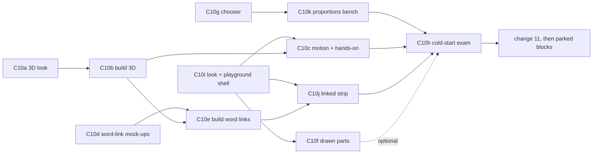

# C10 block log, to 13 Nov 2026

Moved verbatim from `docs/c10-visuals.md` on 13 Nov 2026, when each block's status moved to `docs/map.yaml` and the map page (`tools/block_map.py`). This is history and evidence: report paths, rounds, counts. It is not the current status; `docs/map.yaml` is.

## Status cells of the Blocks table

### C10a

done 8 Nov: B, with the settings line in Decisions; the playground `out/c10/h3d/b2-play.html` opens in it

### C10b

built 9 Nov (shape B), two review rounds, 8 confirmed findings fixed; quick check clean; approved by the user 9 Nov (committed in 3a568a8). Report `out/c10/c10b/report.md`, pictures `out/c10/c10b/before-after-fixes.png`, bench `out/c10/bench/`

### C10i

half 1 done 9 Nov: the user picked the look (Decisions); Argon trial skipped by the user. Quarter labels: C (Decisions). Open `out/c10/c10i/index.html`; report `out/c10/c10i/report.md`. Half 2 built 9 Nov (the look as kit defaults, the `quarters` mark, pca-2 scene 5 redrawn; one review round, 4 confirmed findings fixed; quick check clean): **done, approved by the user 10 Nov**, committed in adbeb22. Report `out/c10/c10i/half2/report.md`; pictures `out/c10/c10i/half2/before-after.png`

### C10g

built 9 Nov (strip, glyph, title + question, plan with `shows`), two review rounds, 9 confirmed findings fixed; quick check clean, 29/29 adv and link cases, six lessons byte-identical; approved by the user 9 Nov (committed in adbeb22). Reports `out/c10/c10g/report.md` (playground), `report-build.md` (build and fixes); pictures `out/c10/c10g/shots/storyboard-script.png`, playground `out/c10/c10g/play.html`

### C10k

built 10 Nov as one adv figure, `chance` (YAML shape B: the units, the share line, the gap and the tick ruler in one item; the kit's own run row is "draw again"; a tally strip of draws). Bench: 80 homes, well against piped water, a child ill in the past month, 18/40 against 9/40 (`out/c10/bench-prop/`). Two review rounds (two Terra reviewers), 6 + 6 confirmed findings fixed; the last fix checked by the orchestrator on the reviewers' probes. Quick check clean, 200/200 class cases, 11/11 doc tests, 32 pictures of the two quick-check lessons identical to the kit before the change. **Done, approved by the user 10 Nov**, committed in adbeb22. Report `out/c10/c10k/report-build.md` (playground rounds: `report.md`); pictures `out/c10/c10k/before-after.png`; playground `out/c10/c10k/play.html`

### C10c

built 10 Nov: for every lesson, the camera glides to a pressed view word, tick numbers fade on a clash, and a run can move between frames; adv-only, `views` on the figure, a `hunt` step (the dragged guess, waits for a real move) and a `split` mark with `foil` (the slanted split with its shortcut ghost), expanded by `scripts/hands.py`. Tried on the H&E bench only. Two review rounds (two Terra reviewers), 20 findings then 8 open items, each confirmed by probe and fixed; the last fixes were not re-reviewed. Quick check clean, 213/213 class cases, 11/11 doc tests. **Done, approved by the user 10 Nov; not committed.** Reports `out/c10/c10c/build/report.md`, `report-fix1.md`, `report-fix2.md` (playground: `out/c10/c10c/report.md`); pictures `out/c10/c10c/build/contact-before-after.png`, `after/hunt.gif`, `after/glide.gif`; playground `out/c10/c10c/play.html`

### C10l

in progress 10 Nov: cold-reader audit (out/c10/c10l/terra-audit.md), research (terra-research.md), committee rounds (sol-design.md, sol-round2.md, argon-take.md, argon-r2.md, sol-r3.md), decisions in out/c10/c10l/synthesis.md. Playground built and gated (out/c10/c10l/play/index.html, report.md; 14 variants, lint 0 errors, browser 0 failed checks, numbers 0 unmatched). Round 3 (the user's message 3, out/c10/c10l/user-ask-3.md): Fable plan + voice guide + rewritten text (r3/fable-plan.md, voice.md, story-full/, story-short/), Argon ideas, Terra facts, Sol engineering review (r3/sol-review-r3.md), two Opus pages, Fable review (r3/fable-review.md) and one fix round. Story starters on 3 topics from one engine (r3/starters/gallery.html; scale audit 0 misses, 2124 numbers recomputed, checks 0 failures) and a short lesson with settings (r3/play/index.html; 4 variants, lint 0 errors, browser 0 failed checks, numbers 0 unmatched, fold term ledger 0 misses). Waiting for the user's picks (starter, look, sheet, voice, refresher); then Opus implements in plugins/ on two lessons, reversing design.md rows 93 (word caps) and 106 (paper in class). Image-model starters: proposed as C10x, the user picks the models. Found: the shipped reference teaches the nickname "stain sheet" (plugins/viz-os/skills/class/board.md:313) (fixed 13 Nov, piece 6) **12 Nov: the user picked the words settings** (Decisions); the look of the round-3 playground is older than C10j and C10n–p and was not judged. Piece 1 of 6, the voice, built 12 Nov (`docs/issues/class.md`, C10l 1–3); piece 2, the step reason inside the teacher line, built 13 Nov (C10l 4–6); piece 3, the extra-reading folds and Study switch, built 13 Nov (C10l 7–9); piece 4, the refresher as an end scene, built 13 Nov (C10l 10–12); piece 5, the transfer think stop, built 13 Nov (C10l 13–15); piece 6, the "stain sheet" nickname replaced by "column space", 13 Nov (C10l 16–17). **All 6 pieces built; nothing committed.** Next: the user's review, then the 5 lessons that warn "no transfer stop" when asked

### C10n

settings line sent by the user 11 Nov (Decisions). Fable 5.2 high reviewed round 1 and Fable 5.2 medium built the ink/dash templates; rounds 3–7 were tuned live and not reviewed by Fable. Open `out/c10/c10n/play.html`; checks `out/c10/c10n/check.py` (0 failures, 11 Nov); rules `palette-rules.md` and `rules-for-later.md` beside it. Not built into the kit. **Edge-case review** (the user asked, 11 Nov): Sol 6.1 xhigh, `out/c10/c10n/sol-review.md`, 20 confirmed findings (blockers: missing counts give NaN bars, all-zero counts give a 0..0 scale, the 3 × 3 guide grid breaks with other gene or guide counts); the check missed a typed number and a title over the tabs. They are fixed once, in C10o's frame, not in this page

### C10o

looked at by the user 11 Nov: the frame, padding and text placement kept; H&E, PCA and the table tab rejected, and colour wanted at rest (fixes in C10p). Built 11 Nov: plan by Fable 5.2 high (`plan.md`: frame, layouts, kinds; 5 compositions; rules R1–R16; 19 of Sol's 20 findings fixed in the new code, `audit_r3.py` repair rejected), Argon's ideas, Opus 5.5 medium built it in two phases. Four figures: CRISPR (`steps`, identical to C10n: 0 differences), H&E pixel (`zoom`, the stain's own colours on a lit ground), two shares (`pair`, countable homes over one ruler), PCA (`linked`, a square plane beside its spread curve). Settings `fig`, `drawer = relayout | scale`, `air`, `pal`. Check `out/c10/c10o/check.py`: 0 failures (rerun by the orchestrator 11 Nov); Sol's 31 cases as expected, 5 of 5 mutations caught; the open drawer lays the figure out again (empty band 171 → 3 px, text ≥ 15 px). Open `out/c10/c10o/gallery.html`; contact sheet `shots/contact.png`; report `report.md`; open items `docs/issues/class.md` (C10o 1–6)

### C10p

started 11 Nov: plan by the orchestrator (Opus 5.5), built by Opus 5.5 in its own session with a stop for the user after each step. Step 2: the user picked the **mint** set. Step 3: the H&E rebuild approved 11 Nov after one round of spacing changes; R17 (no glare) added, `check.py` 0 failures, 7 of 7 mutations caught. Step 4: the user picked **A, pin and protractor** and approved the built PCA 11 Nov (new kind `protractor`; `check.py` 0 failures, 7 of 7 mutations caught; the open drawer's empty area is 15.0 %, at the limit). Step 5: the first five table styles were not kept. The user asked for styles that draw the topic's own objects, one at a time, five in all (plan section "Fix 4, round 2"). Style 1, the **tray**, was kept 11 Nov. For CRISPR it draws the screen's plate, and each well's coloured area is the count. It adds a prop box (`src/props.js`) and R19 (topic props); `check.py` 0 failures, 9 of 9 mutations caught. Style 2, the **tally** sheet, was kept 11 Nov. For the two shares it draws a field survey on a clipboard, one stroke for each home in bundles of five; `check.py` 0 failures, 10 of 10 mutations caught. The user asked that the topic objects can change with the context while the layout is reused. Style 3, colour chips on slides with tubes, was built. On 11 Nov the user dropped all of round 2 and the PCA cards' horizontal bars: "I dont like any of those, get more creative. throw this while current bottle stuff u are trying and those horizontal bars". The code is in `old/round2/`, and R19 is retired. Round 3 builds five new ideas one at a time (plan section "Fix 4, round 3"). Idea 1: the skyline was dropped ("Drop it entirely"). The **stipple** was kept and finished 11 Nov after four rounds of the user's changes: one dot for every 50 reads, wide gutters, no counts at rest, the touched count at the bottom middle in the tile's colour, and the table on one grid with the header. R13 counts the dots; `check.py` 0 failures; birds test case 0 failures. Idea 2, the **bead rings** for the two shares, was kept and finished 11 Nov after one round of changes (a stacked, centred middle; column names capped at one word; larger ring names). Garden test case 0 failures. Idea 3, the **colour wheel** for the H&E pixels, was kept and finished 11 Nov: each pixel a chip of its true colour with a spoke for the red, green and blue light it held back, in plain light colours, names starting with a capital. R13 checks each spoke's length; ponds test case 0 failures. On 11 Nov the user asked for an audit and small blocks, each in its own chat (plan `out/c10/c10p/blocks/plan-blocks.md`, one note per block in `blocks/`). The audit found one lost ask, the link from a figure to its topic, and gave it to the story block. B0 split the shared files into registries, so blocks never edit the same file, and added a real hover, tap and keyboard test. Wave 1 is approved. Idea 4, the **slope lines**, draws the PCA table with small drawn cells ("This is enough"). Idea 5, the **recorder strip**, draws a series with an ink wash under the pen trace, on a growth case and a tide case. The story device is a **guided first look**: at rest the parts the reading names glow, and the reading shows first in the drawer ("i like the c"). It is approved on H&E and PCA, and CRISPR gets it through an R15 exemption ("Yes, exempt it"). The stipple keeps no counts at rest ("No, keep as is"). Wave 2 is done (12 Nov). B1 repaired a defect test that S1 had made blind and put the story check in the gate. S4: the two shares draw homes as houses, filled in their group's colour at rest, with the ruler running on to a round tick and a coloured gap bar ("Yes, houses", "Finish it"). S5a: the zoom and linked layouts on an autumn leaf and on birds, each with its own drawn objects ("more life to it, more texture", "Finish it"). S5b: the steps and pair layouts on bread dough and on seeds in shade and sun ("Approve, finish it"); a figure too big for its canvas now stops with its file and field. CRISPR keeps 20 px of air like every figure ("Make it 20 px"), and R15's reference was re-recorded from the moved drawing (the C10n one kept in `work/ref-c10n/`). E1 done 12 Nov: report `out/c10/c10p/report.md`, contact sheets `shots/e1/`, notes `notes.md`. Sol 6.1 xhigh reviewed the engineering (14 findings); 13 were fixed by two Opus 5.5 medium workers and 1 filed (C10p 10). Gate after the fixes: cases 39, failures 0; checks 0 failures; R15 0 differences; hover 0; story 0; mutations 20 of 20 caught. S6 (started 12 Nov, the user: "send to for a revamp attempt , to add a better touch of topic , artistic details etc"): a CRISPR figure and stipple table revamp in its own chat, drafted as opt-in fields in `cases/s6-crispr/`; it waits for the user's pick. Picks in `out/c10/c10p/decisions.md`

### C10j

**built in `plugins/` 12 Nov, committed with C10c (not pushed)** (shape C, the user's pick: the strip publishes data names, `window`, `window_<f>` and `picked_<f>`, and any kit figure reads them; hand-made art against a contract checked by `class/scripts/art.py`, which writes the hit map build and page both sample). Tried on `out/c10/c10j/lesson-he/` (spots 12, a `space`) and `lesson-blur/` (a 3 × 3 kernel as `slots`, a `calc`); quick check 0 warnings, blur 0, H&E 1 (page size); the empty band under OD space fixed (C10j 2); open items C10j 3–7 in `docs/issues/class.md`. Design for other topics: `out/c10/c10j/general/README.md`. Look approved 12 Nov (lean loop). The user rejected a 40 × 40 noisy pixel grid as the tissue ("dont even think use this quality of asset in our lessons"; kept in `out/c10/c10j/old-grid/`) and asked for drawn vector SVGs. Two delegated drawings: Haiku 5.5 xhigh (`svg/`) and Opus 5.5 medium (`svg-opus/`, picked by the user: 3,378 shapes, colours computed from stain amounts, 1.3 MB; still lilac, because these stain vectors cannot make salmon pink); compare `compare-tissue.png`. Playground `out/c10/c10j/play.html` (`build.py`): the tissue with a draggable window, the window as a grid of spots (each takes the shape drawn on top), the picked spot's numbers step by step, and its point in OD space with the drop and an edge-on view; one shared pointer; optional split (shortcut against joint). Numbers `strip.json` from `make_strip_data.py`, `verify_strip.py` PASS. `shots.py`: 4 settings, 0 console errors, 0 failures; hover, pick, drag, linked words and the edge glide tried once by script. Round 1 settings line from the user (12 Nov): `layout=lead heads=shape bridge=off point=press rest=dim span=96 n=12 cell=gap nums=table cloud=window view=turn split=off`, now the defaults; "very good concept and first round", with less text and less clutter wanted, following the older visual rules. Round 2: one-word heads, the touched shape's name as a head tag, one short line under the figure, the longer reading behind a round `+` (the C10n rules), a 6-row table of 5 narrow columns beside the grid, smaller view buttons, and OD space capped at 420 px. Then, from the user's marked screenshot ("Sticks while the right scrolls?"): in the lead layout the tissue sticks, sized to the screen height, while the window and OD space scroll past it; OD space axes reach only as far as the data. `shots.py` 0 failures, 0 console errors. Round 3 (the user's marked screenshots: text 1.5–2× at 100% Chrome zoom, "Whats with empty space here?", use the full width, align the drawer, centre the line, match the lesson look): the class kit's scene head (boxed mono tag, 34 px title, 21 px lead) and type sizes (heads 20 px, lines and table 17–18 px, axis names 16 px); the page up to 1400 px wide; the `+` drawer in the strip's own columns; the line under OD space centred. The empty band above OD space came from the camera fitting a ball around the long plane, not from the 20 px rule: the camera now fits the drawn parts' screen box, and the figure is only as tall as they are (200–330 px). With the shorter right side the stuck tissue now holds only briefly. `shots.py` 5 settings, 0 failures, 0 console errors. Round 4 (the user, beside the shipped H&E bench: "Where is all these borders of orange etc style from original template"): the class kit's frame, values copied from board.css: the orange top bar for how far down the page you are, the figure frame on the tissue, the window and OD space (thin top line, 64 px orange tick, soft shadow), a 4 px orange step bar hung in the margin of the right column on the step being worked on (window or OD space), and a Think stop under OD space ("Press edge-on. How does the drop meet the plane?", Show answer, So line with computed amounts). Not carried over: the step dots and Back/Next, and the scene rail (one scene here). `shots.py` 0 failures; `shots_view.py` Think answer and step bar checked. Not tested: Firefox, Safari, touch, a screen reader

### C10d

done 9 Nov: A, twin glow (Decisions); mock-ups and report `out/c10/c10d/`

### C10e

built 9 Nov (look A, `==pixel==`), two review rounds, 7 confirmed findings fixed; quick check clean, 156/156 cases; approved by the user 9 Nov (committed in adbeb22). Report `out/c10/c10e/report.md`, pictures `out/c10/c10e/before-after.png`

### C10f

built 12 Nov in `plugins/` from the user's pick (ink on black, Decisions), **approved by the user 12 Nov**. `kit/parts.js` (the 9 parts and their states as SVG ink in the kit's colours), `fork` in `kit/board.js`/`board.css` (wide, the `see` end lit, linked by `via` or `name`), `lint_fork` and 11 class cases `tools/class-cases/fork-*.yaml`, `adv.md` §9b. Tried on two lessons only: `fork-good` (a cell splits) and `out/c10/c10f/lesson-drops/` (droplets with a slider; seeded `make_data.py`, `verify_data.py` PASS). Problems found and fixed, and what is open: `docs/issues/class.md` "The `fork` and drawn parts". `image.py` now refuses maths subjects (exit 3), 12 Nov

### C10h

todo

### later

parked

## Graph, run order and State now, as of 12 Nov

Change 11 of `todo-draw-math.md` (prove it's general) comes after C10h. The user's picture of this map: https://claude.ai/artifact/2r7angg1HBwSeyk2UQMDpV (its status cards are as of 10 Nov, after C10c; this file is the truth).

Run order (9 Nov, chosen for cost): C10i half 1 beside C10g → C10i half 2 → C10k → C10c → C10j → C10f → C10h. The user can stop after any block. 10 Nov: the user put C10l (story and context) before C10j.

## State now (12 Nov)
- C10f (12 Nov): `fork` and the ink parts are built in the class kit and tried on two lessons; approved by the user 12 Nov; `image.py` refuses maths subjects. Nothing committed.
- C10n (11 Nov): the user sent the settings line (Decisions). The playground is mock-up only, in `out/c10/c10n/`. Not built into the kit or a skill yet: the filler-title check and the key-word colours (`rules-for-later.md`), the topic → mono rule (`palette-rules.md`), and the short header tag. Not tested: Firefox, Safari, touch, a screen reader. The dash style was built as a template and the user chose ink.
- C10o (11 Nov): the C10n look as one frame around four different figures, mock-up only (`out/c10/c10o/`). The user kept the frame and rejected H&E, PCA and the table style. Not built into the kit.
- C10p (11 Nov): the fixes, built step by step by Opus 5.5 in its own session with the user (`out/c10/c10p/plan.md`).
- **Now:** C10p is done (E1 report `out/c10/c10p/report.md`; S6 approved and switched on: the gallery's CRISPR is the bench look with the read pileup table, R15 re-recorded from it, the old reference in `work/ref-pre-s6/`). New features run as the lean loop above; C10l (story and context; the user picked the words settings 12 Nov, build next); then C10j. C10c is done (approved 10 Nov; pictures `out/c10/c10c/build/contact-before-after.png`) and committed with C10j on 12 Nov (not pushed). C10e, C10g, C10i and C10k are committed (adbeb22, 10 Nov, not pushed).
- C10c (10 Nov): open after the block, in `docs/issues/class.md` (C10c 1–4): the flat-plane guess is not built; **no shipped run moves smoothly**, because all five pick one data row per frame, and blending rows needs a change in the deck kit's `core.js`; the other lessons are untouched. Also open: on the bench the edge-on gap reads faint, and in the split answer the handle covers the foot dot; the page guards for `hunt` and `split` check the first-draw and slider-end values only; the smooth-run test covers `space` figures only. Not built from the playground: the meter, the trail, the screen-flat right-angle tick, other handles. Not tested: Firefox, Safari, touch, a screen reader, a cold agent, pedagogy. The learner-actions check fails the same two `board-gallery` items with and without the change (94 of 96 on the two quick-check lessons). Agent's YAML on the bench: 12 tokens for `views`, 61 for the hunt, 32 for the split; `adv.md` is 111 lines (§10), `board.md`, `lesson.md` and `SKILL.md` unchanged.
- From the user (10 Nov), on the old bench scene: the `dist` bell curve on a board "feels like it still stuck in old version of the plugin" (boxed labels on the plot, the grey card). It is drawn by the deck kit, which the C10 look never reached; a separate session was proposed for it, not started (`docs/issues/class.md`, Chance 101).
- C10k (10 Nov): the proportions bench is `out/c10/bench-prop/` (`make_data.py` seed 20261110, `verify_data.py` PASS; pooled share 33.75%, one noise step 10.57 points, the gap 22.5 points = 2.13 steps; 11 of 200 draws as far, exact 4.38%, smooth curve 3.33%; clustered step 17.60 points). This seed's draws are a little wide (SD 11.5 against 10.6 points); kept, not picked. The `chance` figure is adv-only (`class/adv.md` §9, now 88 lines). The user's settings line was `units=grid fill=packed axis=shares ruler=ticks ties=on pile=off draw=run layout=over`, then "Kit run row" for the control (`ties` does nothing with `axis=shares`). Open points: `docs/issues/class.md`, Chance 101–107. Earlier open question from the user (9 Nov, still not agreed): Open question from the user (9 Nov): a block for illustrated objects the learner can move (art from kit parts, agent-written SVG or an image model; arrows, measures and numbers always drawn by the kit) and a gallery of ready interactive scenes; proposed to sit after C10c, not yet agreed.
- C10i half 2 (9 Nov): the look is the kit's own default now (tokens in `board.css`; `board.js` draws with them), so a later mock-up built from a real lesson already wears it and needs `out/c10/c10i/look.css` only for its tokens and the shell. Tried on pca-2 and the H&E bench only. Still open: the three rulings below (fill, hues, witness) and the points in `docs/issues/class.md` (Look 95–100).
- C10i half 1 (9 Nov): `out/c10/c10i/` holds `look.css` (the §4 numbers as tokens, then CSS-only rules on the kit's figures), the reference page `index.html`, the shell (`shell.js`, `shell.css`: `PG.init`) and two playgrounds made by `build.py` from real lessons. Later mock-ups import `look.css` and the shell. Four rulings wait for the user (`report.md`): fill passes over the sweep but a plane looks empty at one moment (the kit widens x to fill 16:9; height is the limit); the bench has 5 mark hues against a cap of 4; `wide` gains 18% on a plane and shrinks a 4:3 figure; "the accent mark is the witness" picks the wrong mark on the bench. The Argon trial was skipped by the user. The user's note on pca-2 scene 5 (the four `product +/−` words: misplaced, and not nice in green and pink): the colours came from a look rule that tinted every name with its mark's colour; the look now tints only a name that sits beside a drawn mark, and words written on a plot by themselves stay axis grey. The misplacing is the kit's (the top-left word is right-anchored and crosses the box); `quad.py` draws three cures for a picture only; the user picked C, and building it belongs to half 2.
- Plan v2 (9 Nov): the design is in `c10-plan-v2.md`; the helper reports behind it are in `out/c10/plan2/` (`inventory.md`: which figures the examples use; `refs.md`: the references, ranked; `argon.md`: Argon's ideas).
- Research done: `out/c10/research.md` (Sol 6.1: options and token cost), `out/c10/inspire/notes.md` (Terra: how the reference pages are made), `out/c10/inspire/gptchat.md` (the user's study chat, digested; full text beside it).
- Earlier mock-ups on the leak dial: `out/c10/proto/` (smooth run, finer grid, one pixel's path). The user liked them; the smooth run goes into C10c.
- C10a mock-ups: `out/c10/h3d/` (open `index.html`; `a-flat.html`, `b-cues.html`, `c-lit.html`, `report.md`, `shots/`, `vid/`, data from `make_data.py`, checked by `verify_data.py`: PASS). Shown to the user: `compare-3d-looks.png` (3 looks × 3 views) and `compare-3d-turning.gif`. All three run at 60 frames a second while dragging (headless; WebGL on a software renderer, so GPU speed is untested); C doubles the page weight (283 KB with three.js 0.170.0) and its lighting shifts the dots' true colours.
- C10a playground (8 Nov): `out/c10/h3d/b2-play.html`, built by `build_play.py` from `src/play.css` and `src/play.js`; shots by `play_shots.py` into `play-shots/`; side by side in `compare-playground.png`. It uses the class kit's sliders, toggle words, glass card and frame rule; names are plain coloured words with a halo (no boxes) and a thin leader when far; no text selection or focus ring from a drag; zoom by pinch, ⌘ or ctrl + scroll, the + − buttons or keys; "fit" and "edge" (look along the sheet) buttons; axes sized to the data and the figure fitted to them. The options panel (palette, dot colouring, ground, frame, layout, shape, axes or back panes, ticks, floor, drop lines, depth fade, perspective, sheet, line weight, dot size, names, legend) writes a settings line the user sends back. Page unmixing matches `data.json` to 1.1e-15; no console errors.
- Fix in C10b whatever look wins: the scene fills only about 40% of its plate (one scale for every view; fit it to the plate instead); dragging selects label text in A and B (blue highlight in the GIF; needs `user-select: none`); boxed tags go (colour-matched words instead); "DAB pixel" hides in 8–16% of views; start edge-on when the point is the right angle.
- A teaching point from the data: the DAB pixel, made from 0.30 H, 0.20 E and 0.60 DAB, unmixes to ĥ 0.72, ê 0.27. Part of an unnamed stain is counted as H, not only left in the residual. Use it in the H&E lesson's limits scene.
- Stain vectors used: Ruifrok & Johnston 2001 as given in scikit-image 0.25.0 `rgb_from_hed`: H = [0.65, 0.70, 0.29], E = [0.07, 0.99, 0.11], DAB = [0.27, 0.57, 0.78]. H and E are 39.4° apart; DAB sits 36.5° off their plane.
- Draft of the H&E lesson's picture plan: `out/c10/plan.md` (bottom table).
- C10d mock-ups (9 Nov): `out/c10/c10d/` (`a.html`, `b.html`, `c.html` and `-plane` versions; `compare-word-links.png`, `compare-plane.png`, a GIF per option; `report.md`). Injected script `src/wl.js` / `wl.css` by `build.py`; the kit is untouched. C10e starts from `wl.js` and the clashes listed in `report.md`: `==text==` already means an orange underline, so a typo in a mark name falls back silently (lint it); a linked `==H==` must count as the symbol `$H$`; two linked marks may not share a colour (pixel ring and residual were both orange); plane marks need real pointer areas. Not tested: touch, Safari, Firefox, a narrow window.
