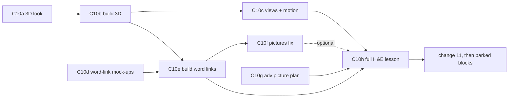

# C10: advanced visuals, in small blocks

Change 10 of `todo-draw-math.md`, split into blocks. **One block per chat.** When the user says "work on C10b" (or "the next C10 block"), read this file and "How we work" in `todo-draw-math.md`, then do that block only, with the loop below. When a block ends, set its status here, add a line under "Decisions", and update "State now".

Goal: a `class` lesson picks the picture that builds the right intuition (geometry, logic, an analogy, a worked case) and draws it as cleanly as the reference pages below. Every number stays computed; the lesson agent still writes short YAML.

## Who does what
| Role | Who | How |
|---|---|---|
| Orchestrator | the strong model the user starts the chat with | plans the block, writes briefs, checks every result, shows the user options, keeps this file current |
| Implementer | Opus 5.5 medium (more effort only if a run fails at medium) | `--to claude --model opus --effort medium --role worker` |
| Technical review | two Terra 6.1 high by default, or Grok 4.7 high when the user says | `--to codex --model gpt-6.1-terra --effort high --role reviewer` / `--to grok --model grok-4.7 --effort high --role reviewer`; two rounds as in "How we work" rule 2; check `git status` after each |
| Quick research, reading | Terra 6.1 high | `--to codex --model gpt-6.1-terra --effort high` |
| Visual review and every design choice | **the user** | picks from 2–3 options shown as pictures or GIFs side by side, never a diff |

All runs go through the agent-delegate dispatcher. If a run's status is not success or its model differs, report `error_message` and `.model` verbatim and stop.

## The loop for every block
1. Read this file, then the block's row and notes.
2. **Options first.** Opus builds 2–3 mock-ups in `out/c10/<block>/` (not in `plugins/`). Check them yourself (screenshots, console errors, numbers), then show the user the options side by side, each with its YAML and token cost when the agent will write it. Ask which one. Repeat until the user picks.
3. Opus implements the pick in `plugins/viz-os/skills/class/` and tests it on **one lesson**: the H&E bench (`out/c10/bench/`, made in C10b). User's rule, 8 Nov: kit changes and fixes are tested on one lesson.
4. Two reviewers, two rounds; Opus fixes what both confirm; you settle disputes by reading code or running a probe.
5. Rerun the test yourself; show the user before/after pictures; wait for approval.
6. Set the status, add a Decisions line, update "State now". Commit only when the user says.

Only one block edits `plugins/` at a time. Blocks that only make mock-ups (C10d, the first half of C10g) can run in a second chat beside it.

## Blocks
Your part: **pick** = choose between options; **review** = look at the result and approve; **tell** = give a fact only you have.

| Block | What | Your part | After | Status |
|---|---|---|---|---|
| C10a | 3D look: three mock-ups of the stain-plane scene: flat SVG, SVG with depth cues (floor grid, drop lines), lit WebGL (three.js) | pick a look, plus tweaks | — | done 8 Nov: B, with the settings line in Decisions; the playground `out/c10/h3d/b2-play.html` opens in it |
| C10b | Build the 3D figure `space`: the `plane` marks with a z, plus `sheet` (the span of two vectors) and `foot` onto a sheet; drag to turn; lint; ≤ 40 lines in `board.md`. Starts by showing 2 YAML shapes with token counts. Also makes the H&E bench lesson | pick the YAML shape; review | C10a | built 9 Nov (shape B), two review rounds, 8 confirmed findings fixed; quick check clean; waiting for the user's approval. Report `out/c10/c10b/report.md`, pictures `out/c10/c10b/before-after-fixes.png`, bench `out/c10/bench/` |
| C10c | Views and motion: a named view per step (`edge` turns the sheet edge-on so the right angle shows), the camera glides between steps, and the smooth run from the earlier mock-up (`out/c10/proto/`) | pick the glide feel from GIFs; review | C10b | todo |
| C10d | Colour-matched words, mock-ups only: 2–3 ways a coloured word in a teacher line and its mark light each other up | pick | — | todo |
| C10e | Build the word links for `plane`, `chart` and `space`; names drawn on figures become rare; lint: each coloured mark has its coloured word in the scene | review | C10b, C10d | todo |
| C10f | Pictures fix: `image.py` refuses maths subjects (vector, plane, axis, arrow, graph); picture labels become small anchors tied to coloured words; redo the three slop scenes | tell which image tool; pick the anchor look; review | C10e | todo |
| C10g | Adv picture plan: with "adv", the lesson agent shows a plan per scene (intuition, visual, analogy, must see) before building; new moves in `class/adv.md` (edge-on view, geometry-to-algebra bridge, everyday analogy with its mapping and where it breaks, prerequisites road-map); `lesson.md` ≤ +10 lines | pick the plan format; review | — | todo |
| C10h | The full H&E lesson in adv mode, built by a cold agent from `plugins/` only; compared with the user's study chat | study it and judge | C10c, C10e, C10g | todo |
| later | Linked views (CNN-explainer style), illustrated parts from an image model, the agent-written widget (only from the kit's parts, browser-checked) | pick | C10h | parked |

Change 11 of `todo-draw-math.md` (prove it's general) comes after C10h. The user's picture of this map: https://claude.ai/artifact/2r7angg1HBwSeyk2UQMDpV (its status cards are as of 8 Nov; this file is the truth).

## State now (8 Nov)
- Research done: `out/c10/research.md` (Sol 6.1: options and token cost), `out/c10/inspire/notes.md` (Terra: how the reference pages are made), `out/c10/inspire/gptchat.md` (the user's study chat, digested; full text beside it).
- Earlier mock-ups on the leak dial: `out/c10/proto/` (smooth run, finer grid, one pixel's path). The user liked them; the smooth run goes into C10c.
- C10a mock-ups: `out/c10/h3d/` (open `index.html`; `a-flat.html`, `b-cues.html`, `c-lit.html`, `report.md`, `shots/`, `vid/`, data from `make_data.py`, checked by `verify_data.py`: PASS). Shown to the user: `compare-3d-looks.png` (3 looks × 3 views) and `compare-3d-turning.gif`. All three run at 60 frames a second while dragging (headless; WebGL on a software renderer, so GPU speed is untested); C doubles the page weight (283 KB with three.js 0.170.0) and its lighting shifts the dots' true colours.
- C10a playground (8 Nov): `out/c10/h3d/b2-play.html`, built by `build_play.py` from `src/play.css` and `src/play.js`; shots by `play_shots.py` into `play-shots/`; side by side in `compare-playground.png`. It uses the class kit's sliders, toggle words, glass card and frame rule; names are plain coloured words with a halo (no boxes) and a thin leader when far; no text selection or focus ring from a drag; zoom by pinch, ⌘ or ctrl + scroll, the + − buttons or keys; "fit" and "edge" (look along the sheet) buttons; axes sized to the data and the figure fitted to them. The options panel (palette, dot colouring, ground, frame, layout, shape, axes or back panes, ticks, floor, drop lines, depth fade, perspective, sheet, line weight, dot size, names, legend) writes a settings line the user sends back. Page unmixing matches `data.json` to 1.1e-15; no console errors.
- Fix in C10b whatever look wins: the scene fills only about 40% of its plate (one scale for every view; fit it to the plate instead); dragging selects label text in A and B (blue highlight in the GIF; needs `user-select: none`); boxed tags go (colour-matched words instead); "DAB pixel" hides in 8–16% of views; start edge-on when the point is the right angle.
- A teaching point from the data: the DAB pixel, made from 0.30 H, 0.20 E and 0.60 DAB, unmixes to ĥ 0.72, ê 0.27. Part of an unnamed stain is counted as H, not only left in the residual. Use it in the H&E lesson's limits scene.
- Stain vectors used: Ruifrok & Johnston 2001 as given in scikit-image 0.25.0 `rgb_from_hed`: H = [0.65, 0.70, 0.29], E = [0.07, 0.99, 0.11], DAB = [0.27, 0.57, 0.78]. H and E are 39.4° apart; DAB sits 36.5° off their plane.
- Draft of the H&E lesson's picture plan: `out/c10/plan.md` (bottom table).

## What the user wants and likes (C10)
- Visuals chosen for intuition: the right picture, analogy or worked case, the way their ChatGPT study chats choose (prerequisites first, observed / predicted / residual together, an edge-on view, every multiplication traced, a tempting shortcut compared with the answer).
- The look of the references, as inspiration, never copies: [ciechanow.ski](https://ciechanow.ski/bicycle/) (one control drives one visible cause and effect; clean; no overlaps; good colours), [Pele diagrams](https://pele-art-diagrams.vercel.app/) (labels laid out before drawing; one restrained palette), [kevintngo.com](https://kevintngo.com) (detail and craft), [CNN Explainer](https://poloclub.github.io/cnn-explainer/) (linked views).
- Dislikes: image-model pictures that draw the maths, and dark label boxes pasted over the figure ("slop").
- Labels: colour-matched words. The figure carries almost no text; a mark shares its colour with a word in the teacher lines; pointing opens the card.
- Pictures from an image model only when the user asks; the user names the tool.
- Shown options often, as pictures; token-efficient YAML without losing quality.

## Decisions (C10)
- 9 Nov (C10b): `space` takes shape B (named vectors); the kit sizes the axes by sampling 5 values per control (all combinations up to 4096, then a seeded sample) and warns if a mark later leaves them; `edge` searches every direction in the sheet and turns perspective off while edge-on (back to mild on the first drag); a span thinner than sin 1e-6 draws no foot and warns.
- 8 Nov (C10a), the look C10b builds: `palette=kit dots=true bg=page frame=kit layout=beside shape=r43 axes=lines ticks=on floor=grid drops=off depth=on persp=mild sheet=tint weight=fine size=m names=legend legend=on`. So: kit violet/pink, dots in true colour, the kit frame rule, figure beside the text at 4:3, three axes with tick numbers over a floor grid, no drop lines, depth fade and mild perspective, the sheet tinted from E to H, fine lines; no mark names on the figure (only axis names), the legend row names the marks and lights them on hover. Zoom with a plain mouse scroll toward the pointer; scrolling down at the fitted size scrolls the page, so a reader moving down the lesson is never caught; pinch or ⌘/ctrl + scroll can go below the fitted size; + / − / fit / edge buttons stay.
- 8 Nov (C10a): the user picked B, SVG with depth cues, and asked for zoom and a better look; the 3D figure reuses the class kit's controls, not its own control strip.
- 8 Nov: test bench is H&E colour unmixing (least squares onto the stain plane). First kind: 3D you can turn. The picture plan is shown only when the user says "adv". Kit first; an agent-written widget later, built only from kit parts. Labels: colour-matched words. After 3D: the labels and pictures fix.
