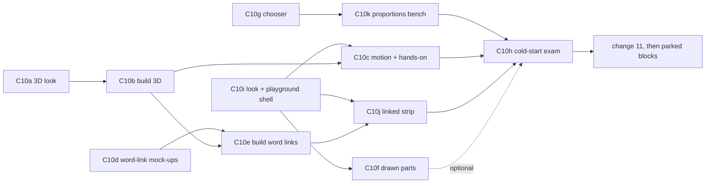

# C10: advanced visuals, in small blocks

Change 10 of `todo-draw-math.md`, split into blocks. A new planner reads [c10-handoff.md](c10-handoff.md) first (the user's wishes, sources, delegation), then its block's rows in the design, [c10-plan-v2.md](c10-plan-v2.md) (the chooser, the look as numbers, what each block adds, which pictures to name in briefs). **One block per chat.** When the user says "work on C10b" (or "the next C10 block"), read this file and "How we work" in `todo-draw-math.md`, then do that block only, with the loop below. When a block ends, set its status here, add a line under "Decisions", and update "State now".

Goal: a `class` lesson picks the picture that builds the right intuition (geometry, logic, an analogy, a worked case) and draws it as cleanly as the reference pages below. Every number stays computed; the lesson agent still writes short YAML.

## Who does what
| Role | Who | How |
|---|---|---|
| Orchestrator | the strong model the user starts the chat with (Fable, high) | plans the block, writes briefs, holds the design gate, shows the user options, keeps this file current. Builds nothing a cheaper worker can build (the two exceptions are in the handoff) |
| Implementer: mock-ups, playgrounds, kit, lint | Opus 5.5 medium (more effort only if a run fails at medium) | `--to claude --model opus --effort medium --role worker` |
| Technical review | Terra 6.1 high, or Grok 4.7 high when the user says. **In proportion (the user, 9 Nov; replaces "How we work" rule 2 for C10):** a mock-up block gets none; a kit change under about 150 lines gets one reviewer, one round, plus the orchestrator's probe; a larger change gets two reviewers, two rounds | `--to codex --model gpt-6.1-terra --effort high --role reviewer` / `--to grok --model grok-4.7 --effort high --role reviewer`; check `git status` after each |
| Reading, finding, screenshots, first-pass checks | Terra 6.1 high | `--to codex --model gpt-6.1-terra --effort high` |
| Second eye on design (untried: the user skipped the C10i trial, 9 Nov) | Gemini 4 Argon high | `--to agy --model gemini-4-argon-high --effort high --role reviewer` |
| Visual review and every design choice | **the user** | picks in a playground (the figure, an options panel, a settings line to send back); a picture or GIF only for a choice with one setting; never a diff |

All runs go through the agent-delegate dispatcher. If a run's status is not success or its model differs, report `error_message` and `.model` verbatim and stop.

## The lean loop while a look is found (the user, 12 Nov; replaces steps 3, 5 and 6 below until the look is approved)
The user: "first lets get the look right , keep those testing for later once the look is approved". Sol 6.1 xhigh agreed in an independent review: keep the fast number checks, pause the rest.
1. One Opus 5.5 medium chat per feature, started with a short brief: the goal, the user's words, the files it owns, the reference picture. No orchestrator gate and no reviewer while the look is open.
2. Each edit: build the gallery only (`python3 build.py`), then `python3 check.py --quick --fig <figure>` (about 24 s on CRISPR, 12 Nov). It prints only failures. Numbers (R12, R13, R10), legibility (R2, R7, R8, smallest mark), the 20 px air and console errors fail; spacing, word counts, palette and glare are notes; R15 is skipped.
3. Show the user one early picture, and one more only when it answers a real choice. No contact sheets, no reports.
4. On "approved": one decisions line and a short block note (at most 20 lines).
5. Paused until a figure goes into the plugin: the full `check.py`, `mutate.py`, `hover.py`, all cases, R15 against the approved look, and one focused review of numbers and interaction. They stay in the folder; nothing was deleted. R3, R4, R16 and R18 judge taste, so they are now notes, never failures.

## The loop for every block
1. Read this file, then the block's row and notes, then its rows in the design. Open the 2–4 reference pictures the design names for the block.
2. **Options first.** Opus builds the options as a playground in `out/c10/<block>/` (not in `plugins/`), on the shared look stylesheet and playground shell from C10i. Every brief has a "Look at" part: the look file and those pictures by path, each with one line to borrow and one not to copy.
3. **Design gate.** Open the screenshots yourself and hold them against the look numbers (design §4) and the references; also check console errors and numbers. Send it back to Opus once if it fails. Only then show the user, with the YAML and its token cost when the agent will write it. Repeat until the user sends a settings line.
4. Opus implements the pick in `plugins/viz-os/skills/class/` and tests it on the benches it touches: H&E (`out/c10/bench/`) and the proportions bench (`out/c10/bench-prop/`). It tries the change on 1–2 lessons of different types only and fixes no other lesson (the rule in `AGENTS.md`). Something that needs no extra reading or YAML goes to every lesson; anything else is adv-only (design §2).
5. Review in proportion (the table above); Opus fixes what is confirmed; you settle disputes by reading code or running a probe.
6. Rerun the test yourself; show the user before/after pictures; wait for approval.
7. Set the status, add a Decisions line, update "State now". Commit only when the user says.

Only one block edits `plugins/` at a time. Blocks that only make mock-ups (C10d, the first half of C10g) can run in a second chat beside it.

## Blocks
Your part: **pick** = choose between options; **review** = look at the result and approve; **tell** = give a fact only you have.

| Block | What | Your part | After | Status |
|---|---|---|---|---|
| C10a | 3D look: three mock-ups of the stain-plane scene: flat SVG, SVG with depth cues (floor grid, drop lines), lit WebGL (three.js) | pick a look, plus tweaks | — | done 8 Nov: B, with the settings line in Decisions; the playground `out/c10/h3d/b2-play.html` opens in it |
| C10b | Build the 3D figure `space`: the `plane` marks with a z, plus `sheet` (the span of two vectors) and `foot` onto a sheet; drag to turn; lint; ≤ 40 lines in `board.md`. Starts by showing 2 YAML shapes with token counts. Also makes the H&E bench lesson | pick the YAML shape; review | C10a | built 9 Nov (shape B), two review rounds, 8 confirmed findings fixed; quick check clean; approved by the user 9 Nov (committed in 3a568a8). Report `out/c10/c10b/report.md`, pictures `out/c10/c10b/before-after-fixes.png`, bench `out/c10/bench/` |
| C10i | Look and playground shell. Half 1 (mock-up only; can run beside C10g): the look numbers as one stylesheet and a reference page, plus a reusable playground shell from `out/c10/h3d/src/play.js`; the orchestrator writes the look page by hand; Argon critiques the same screenshots as a trial. Half 2: the picked look becomes the kit's default for every lesson | pick the look in the playground; review | — | half 1 done 9 Nov: the user picked the look (Decisions); Argon trial skipped by the user. Quarter labels: C (Decisions). Open `out/c10/c10i/index.html`; report `out/c10/c10i/report.md`. Half 2 built 9 Nov (the look as kit defaults, the `quarters` mark, pca-2 scene 5 redrawn; one review round, 4 confirmed findings fixed; quick check clean): **done, approved by the user 10 Nov**, committed in adbeb22. Report `out/c10/c10i/half2/report.md`; pictures `out/c10/c10i/half2/before-after.png` |
| C10g | Chooser, adv only: `class/adv.md` (74 lines) with the idea table (a menu: a scene may state its own question), the depth budget, the figure contract (witness, handle, foil) and the picture plan as stub scenes (`idea`, `see`, `shows`); lint checks; `scripts/storyboard.py` draws the plan as `storyboard.svg`; `SKILL.md` +2 lines. Uses only what the kit already draws | pick the plan and storyboard format; review | — | built 9 Nov (strip, glyph, title + question, plan with `shows`), two review rounds, 9 confirmed findings fixed; quick check clean, 29/29 adv and link cases, six lessons byte-identical; approved by the user 9 Nov (committed in adbeb22). Reports `out/c10/c10g/report.md` (playground), `report-build.md` (build and fixes); pictures `out/c10/c10g/shots/storyboard-script.png`, playground `out/c10/c10g/play.html` |
| C10k | Proportions bench and chance: a second bench lesson on a test of proportions; counts as `units`; `span` and `ruler` marks; "draw again" as a run over seeded draws | tell the exact question and toy table; pick the ruler look; review | C10g | built 10 Nov as one adv figure, `chance` (YAML shape B: the units, the share line, the gap and the tick ruler in one item; the kit's own run row is "draw again"; a tally strip of draws). Bench: 80 homes, well against piped water, a child ill in the past month, 18/40 against 9/40 (`out/c10/bench-prop/`). Two review rounds (two Terra reviewers), 6 + 6 confirmed findings fixed; the last fix checked by the orchestrator on the reviewers' probes. Quick check clean, 200/200 class cases, 11/11 doc tests, 32 pictures of the two quick-check lessons identical to the kit before the change. **Done, approved by the user 10 Nov**, committed in adbeb22. Report `out/c10/c10k/report-build.md` (playground rounds: `report.md`); pictures `out/c10/c10k/before-after.png`; playground `out/c10/c10k/play.html` |
| C10c | Motion and hands-on: a named view per step (`edge` turns the sheet edge-on so the right angle shows), the camera glides between steps, the smooth run from the earlier mock-up (`out/c10/proto/`); plus a guess the learner drags on the sheet or plane, a predict stop that waits for the drag, `decomp` (the slanted split), and the edge-view tick clash | pick the glide feel, the handle and the reveal in the playground; review | C10b, C10i | built 10 Nov: for every lesson, the camera glides to a pressed view word, tick numbers fade on a clash, and a run can move between frames; adv-only, `views` on the figure, a `hunt` step (the dragged guess, waits for a real move) and a `split` mark with `foil` (the slanted split with its shortcut ghost), expanded by `scripts/hands.py`. Tried on the H&E bench only. Two review rounds (two Terra reviewers), 20 findings then 8 open items, each confirmed by probe and fixed; the last fixes were not re-reviewed. Quick check clean, 213/213 class cases, 11/11 doc tests. **Done, approved by the user 10 Nov; not committed.** Reports `out/c10/c10c/build/report.md`, `report-fix1.md`, `report-fix2.md` (playground: `out/c10/c10c/report.md`); pictures `out/c10/c10c/build/contact-before-after.png`, `after/hunt.gif`, `after/glide.gif`; playground `out/c10/c10c/play.html` |
| C10l | Story and context (the user, 10 Nov; runs before C10j): a cold learner must know, from the visible page, what the data is and where it comes from, each object's kind and shape (one number, a list, a table, a share), what every term means (plain words and the field's real name, in the order the learner picks), why each operation is done, what it changed and what that means, and where the same move works in another field. Writing contract and review questions rather than a fixed order; real terms over coined nicknames; computed shape captions; a wording question in the probe; extra reading on demand trialled in a playground. The user's words: `out/c10/c10l/user-ask.md` | pick the opening route, wording order and extra-reading form in a playground; review | — | in progress 10 Nov: cold-reader audit (out/c10/c10l/terra-audit.md), research (terra-research.md), committee rounds (sol-design.md, sol-round2.md, argon-take.md, argon-r2.md, sol-r3.md), decisions in out/c10/c10l/synthesis.md. Playground built and gated (out/c10/c10l/play/index.html, report.md; 14 variants, lint 0 errors, browser 0 failed checks, numbers 0 unmatched). Round 3 (the user's message 3, out/c10/c10l/user-ask-3.md): Fable plan + voice guide + rewritten text (r3/fable-plan.md, voice.md, story-full/, story-short/), Argon ideas, Terra facts, Sol engineering review (r3/sol-review-r3.md), two Opus pages, Fable review (r3/fable-review.md) and one fix round. Story starters on 3 topics from one engine (r3/starters/gallery.html; scale audit 0 misses, 2124 numbers recomputed, checks 0 failures) and a short lesson with settings (r3/play/index.html; 4 variants, lint 0 errors, browser 0 failed checks, numbers 0 unmatched, fold term ledger 0 misses). Waiting for the user's picks (starter, look, sheet, voice, refresher); then Opus implements in plugins/ on two lessons, reversing design.md rows 93 (word caps) and 106 (paper in class). Image-model starters: proposed as C10x, the user picks the models. Found: the shipped reference teaches the nickname "stain sheet" (plugins/viz-os/skills/class/board.md:313) |
| C10n | Starter look lab (the user, 10 Nov): one story-starter figure, the CRISPR knockout screen (now titled "How a knockout screen counts its guides"), and its count table, tuned live with the user: one figure fills the canvas the user drew (about 1,335 × 730 px at 1,440 wide), at most 1–2 short lines on it and the rest behind a `+` toggle that makes room, no orange box on the touched part, the ink look on black, and a default palette with a rule (black and orange theme, class colours, the subject's own colours when it has them). Mock-up only. Handoff and the user's words: `out/c10/c10n/handoff.md`, `user-ask.md`, `feedback/` | pick in the playground and send a settings line; guide with Fable | C10l round 3 | settings line sent by the user 11 Nov (Decisions). Fable 5.2 high reviewed round 1 and Fable 5.2 medium built the ink/dash templates; rounds 3–7 were tuned live and not reviewed by Fable. Open `out/c10/c10n/play.html`; checks `out/c10/c10n/check.py` (0 failures, 11 Nov); rules `palette-rules.md` and `rules-for-later.md` beside it. Not built into the kit. **Edge-case review** (the user asked, 11 Nov): Sol 6.1 xhigh, `out/c10/c10n/sol-review.md`, 20 confirmed findings (blockers: missing counts give NaN bars, all-zero counts give a 0..0 scale, the 3 × 3 guide grid breaks with other gene or guide counts); the check missed a typed number and a title over the tabs. They are fixed once, in C10o's frame, not in this page |
| C10o | One frame, many figures (the user, 11 Nov: "generalize that template so that i dont get the exact same plots everything but the style with good padding, text placements and diverse examples or types of visuals"). The C10n style stays (frame, spacing, drawer, glow, ink, palette rule); the picture changes with the topic. Three layers: the frame, a few layouts chosen by the story's shape, and drawing kinds chosen by the data's shape. A gallery of 4–5 figures on data that already exist, each with its table tab, the CRISPR figure re-hosted unchanged. Mock-up only. Draft `out/c10/c10o/plan-draft.md`, Argon's ideas `argon-ideas.md`, plan `plan.md` (Fable) | pick in the gallery | C10n | looked at by the user 11 Nov: the frame, padding and text placement kept; H&E, PCA and the table tab rejected, and colour wanted at rest (fixes in C10p). Built 11 Nov: plan by Fable 5.2 high (`plan.md`: frame, layouts, kinds; 5 compositions; rules R1–R16; 19 of Sol's 20 findings fixed in the new code, `audit_r3.py` repair rejected), Argon's ideas, Opus 5.5 medium built it in two phases. Four figures: CRISPR (`steps`, identical to C10n: 0 differences), H&E pixel (`zoom`, the stain's own colours on a lit ground), two shares (`pair`, countable homes over one ruler), PCA (`linked`, a square plane beside its spread curve). Settings `fig`, `drawer = relayout | scale`, `air`, `pal`. Check `out/c10/c10o/check.py`: 0 failures (rerun by the orchestrator 11 Nov); Sol's 31 cases as expected, 5 of 5 mutations caught; the open drawer lays the figure out again (empty band 171 → 3 px, text ≥ 15 px). Open `out/c10/c10o/gallery.html`; contact sheet `shots/contact.png`; report `report.md`; open items `docs/issues/class.md` (C10o 1–6) |
| C10p | Fixes from the user's look at C10o (11 Nov). H&E "just terrible looking visual overall" (light slide and lens fills, flat shapes, white tubes where red, green and blue were wanted); PCA "just straight up regular"; the table tab needs "other styles as well"; "keeping mono color for the starting story page isnt the best option". Liked: the drawn style and text of C10l round 3 `he-gels`. Five fixes: colour at rest (`pal = theme`, identity colours exempt from the orange bar, touched cue proved in grey scale), H&E rebuilt from the `he-slide` starter, PCA drawn (pin and protractor, or shadow ruler), five table styles chosen by the data, and the C10o leftovers. New rules R17 (no glare) and R18 (table variety). Mock-up only. Plan `out/c10/c10p/plan.md`, the user's screenshots `feedback/` | review each step with the Opus session | C10o | started 11 Nov: plan by the orchestrator (Opus 5.5), built by Opus 5.5 in its own session with a stop for the user after each step. Step 2: the user picked the **mint** set. Step 3: the H&E rebuild approved 11 Nov after one round of spacing changes; R17 (no glare) added, `check.py` 0 failures, 7 of 7 mutations caught. Step 4: the user picked **A, pin and protractor** and approved the built PCA 11 Nov (new kind `protractor`; `check.py` 0 failures, 7 of 7 mutations caught; the open drawer's empty area is 15.0 %, at the limit). Step 5: the first five table styles were not kept. The user asked for styles that draw the topic's own objects, one at a time, five in all (plan section "Fix 4, round 2"). Style 1, the **tray**, was kept 11 Nov. For CRISPR it draws the screen's plate, and each well's coloured area is the count. It adds a prop box (`src/props.js`) and R19 (topic props); `check.py` 0 failures, 9 of 9 mutations caught. Style 2, the **tally** sheet, was kept 11 Nov. For the two shares it draws a field survey on a clipboard, one stroke for each home in bundles of five; `check.py` 0 failures, 10 of 10 mutations caught. The user asked that the topic objects can change with the context while the layout is reused. Style 3, colour chips on slides with tubes, was built. On 11 Nov the user dropped all of round 2 and the PCA cards' horizontal bars: "I dont like any of those, get more creative. throw this while current bottle stuff u are trying and those horizontal bars". The code is in `old/round2/`, and R19 is retired. Round 3 builds five new ideas one at a time (plan section "Fix 4, round 3"). Idea 1: the skyline was dropped ("Drop it entirely"). The **stipple** was kept and finished 11 Nov after four rounds of the user's changes: one dot for every 50 reads, wide gutters, no counts at rest, the touched count at the bottom middle in the tile's colour, and the table on one grid with the header. R13 counts the dots; `check.py` 0 failures; birds test case 0 failures. Idea 2, the **bead rings** for the two shares, was kept and finished 11 Nov after one round of changes (a stacked, centred middle; column names capped at one word; larger ring names). Garden test case 0 failures. Idea 3, the **colour wheel** for the H&E pixels, was kept and finished 11 Nov: each pixel a chip of its true colour with a spoke for the red, green and blue light it held back, in plain light colours, names starting with a capital. R13 checks each spoke's length; ponds test case 0 failures. On 11 Nov the user asked for an audit and small blocks, each in its own chat (plan `out/c10/c10p/blocks/plan-blocks.md`, one note per block in `blocks/`). The audit found one lost ask, the link from a figure to its topic, and gave it to the story block. B0 split the shared files into registries, so blocks never edit the same file, and added a real hover, tap and keyboard test. Wave 1 is approved. Idea 4, the **slope lines**, draws the PCA table with small drawn cells ("This is enough"). Idea 5, the **recorder strip**, draws a series with an ink wash under the pen trace, on a growth case and a tide case. The story device is a **guided first look**: at rest the parts the reading names glow, and the reading shows first in the drawer ("i like the c"). It is approved on H&E and PCA, and CRISPR gets it through an R15 exemption ("Yes, exempt it"). The stipple keeps no counts at rest ("No, keep as is"). Wave 2 is done (12 Nov). B1 repaired a defect test that S1 had made blind and put the story check in the gate. S4: the two shares draw homes as houses, filled in their group's colour at rest, with the ruler running on to a round tick and a coloured gap bar ("Yes, houses", "Finish it"). S5a: the zoom and linked layouts on an autumn leaf and on birds, each with its own drawn objects ("more life to it, more texture", "Finish it"). S5b: the steps and pair layouts on bread dough and on seeds in shade and sun ("Approve, finish it"); a figure too big for its canvas now stops with its file and field. CRISPR keeps 20 px of air like every figure ("Make it 20 px"), and R15's reference was re-recorded from the moved drawing (the C10n one kept in `work/ref-c10n/`). E1 done 12 Nov: report `out/c10/c10p/report.md`, contact sheets `shots/e1/`, notes `notes.md`. Sol 6.1 xhigh reviewed the engineering (14 findings); 13 were fixed by two Opus 5.5 medium workers and 1 filed (C10p 10). Gate after the fixes: cases 39, failures 0; checks 0 failures; R15 0 differences; hover 0; story 0; mutations 20 of 20 caught. S6 (started 12 Nov, the user: "send to for a revamp attempt , to add a better touch of topic , artistic details etc"): a CRISPR figure and stipple table revamp in its own chat, drafted as opt-in fields in `cases/s6-crispr/`; it waits for the user's pick. Picks in `out/c10/c10p/decisions.md` |
| C10j | Linked strip: one shared pointer (a table row, its dot, its product row and its patch cell light together), `patch` (a grid of cells in their computed colours, one pickable), the `strip` stage. Redraws the three slop scenes without an image model | pick patch and strip layout; review | C10e, C10i | **built in `plugins/` 12 Nov, committed with C10c (not pushed)** (shape C, the user's pick: the strip publishes data names, `window`, `window_<f>` and `picked_<f>`, and any kit figure reads them; hand-made art against a contract checked by `class/scripts/art.py`, which writes the hit map build and page both sample). Tried on `out/c10/c10j/lesson-he/` (spots 12, a `space`) and `lesson-blur/` (a 3 × 3 kernel as `slots`, a `calc`); quick check 0 warnings, blur 0, H&E 1 (page size); the empty band under OD space fixed (C10j 2); open items C10j 3–7 in `docs/issues/class.md`. Design for other topics: `out/c10/c10j/general/README.md`. Look approved 12 Nov (lean loop). The user rejected a 40 × 40 noisy pixel grid as the tissue ("dont even think use this quality of asset in our lessons"; kept in `out/c10/c10j/old-grid/`) and asked for drawn vector SVGs. Two delegated drawings: Haiku 5.5 xhigh (`svg/`) and Opus 5.5 medium (`svg-opus/`, picked by the user: 3,378 shapes, colours computed from stain amounts, 1.3 MB; still lilac, because these stain vectors cannot make salmon pink); compare `compare-tissue.png`. Playground `out/c10/c10j/play.html` (`build.py`): the tissue with a draggable window, the window as a grid of spots (each takes the shape drawn on top), the picked spot's numbers step by step, and its point in OD space with the drop and an edge-on view; one shared pointer; optional split (shortcut against joint). Numbers `strip.json` from `make_strip_data.py`, `verify_strip.py` PASS. `shots.py`: 4 settings, 0 console errors, 0 failures; hover, pick, drag, linked words and the edge glide tried once by script. Round 1 settings line from the user (12 Nov): `layout=lead heads=shape bridge=off point=press rest=dim span=96 n=12 cell=gap nums=table cloud=window view=turn split=off`, now the defaults; "very good concept and first round", with less text and less clutter wanted, following the older visual rules. Round 2: one-word heads, the touched shape's name as a head tag, one short line under the figure, the longer reading behind a round `+` (the C10n rules), a 6-row table of 5 narrow columns beside the grid, smaller view buttons, and OD space capped at 420 px. Then, from the user's marked screenshot ("Sticks while the right scrolls?"): in the lead layout the tissue sticks, sized to the screen height, while the window and OD space scroll past it; OD space axes reach only as far as the data. `shots.py` 0 failures, 0 console errors. Round 3 (the user's marked screenshots: text 1.5–2× at 100% Chrome zoom, "Whats with empty space here?", use the full width, align the drawer, centre the line, match the lesson look): the class kit's scene head (boxed mono tag, 34 px title, 21 px lead) and type sizes (heads 20 px, lines and table 17–18 px, axis names 16 px); the page up to 1400 px wide; the `+` drawer in the strip's own columns; the line under OD space centred. The empty band above OD space came from the camera fitting a ball around the long plane, not from the 20 px rule: the camera now fits the drawn parts' screen box, and the figure is only as tall as they are (200–330 px). With the shorter right side the stuck tissue now holds only briefly. `shots.py` 5 settings, 0 failures, 0 console errors. Round 4 (the user, beside the shipped H&E bench: "Where is all these borders of orange etc style from original template"): the class kit's frame, values copied from board.css: the orange top bar for how far down the page you are, the figure frame on the tissue, the window and OD space (thin top line, 64 px orange tick, soft shadow), a 4 px orange step bar hung in the margin of the right column on the step being worked on (window or OD space), and a Think stop under OD space ("Press edge-on. How does the drop meet the plane?", Show answer, So line with computed amounts). Not carried over: the step dots and Back/Next, and the scene rail (one scene here). `shots.py` 0 failures; `shots_view.py` Think answer and step bar checked. Not tested: Firefox, Safari, touch, a screen reader |
| C10d | Colour-matched words, mock-ups only: 2–3 ways a coloured word in a teacher line and its mark light each other up | pick | — | done 9 Nov: A, twin glow (Decisions); mock-ups and report `out/c10/c10d/` |
| C10e | Build the word links for `plane`, `chart` and `space`; names drawn on figures become rare; lint: each coloured mark has its coloured word in the scene | review | C10b, C10d | built 9 Nov (look A, `==pixel==`), two review rounds, 7 confirmed findings fixed; quick check clean, 156/156 cases; approved by the user 9 Nov (committed in adbeb22). Report `out/c10/c10e/report.md`, pictures `out/c10/c10e/before-after.png` |
| C10f | Drawn parts: the sketch skill's parts (cell, nucleus, chromosome, tissue, tube, plate, read, droplet, lens) usable on a board; `fork` for 2–3 aligned outcomes; `image.py` refuses maths subjects (vector, plane, axis, arrow, graph). Anchors for image-model labels wait until the user asks for image-model pictures | pick dark-ink or paper-plate look and the layouts; review | C10i | built 12 Nov in `plugins/` from the user's pick (ink on black, Decisions), **approved by the user 12 Nov**. `kit/parts.js` (the 9 parts and their states as SVG ink in the kit's colours), `fork` in `kit/board.js`/`board.css` (wide, the `see` end lit, linked by `via` or `name`), `lint_fork` and 11 class cases `tools/class-cases/fork-*.yaml`, `adv.md` §9b. Tried on two lessons only: `fork-good` (a cell splits) and `out/c10/c10f/lesson-drops/` (droplets with a slider; seeded `make_data.py`, `verify_data.py` PASS). Problems found and fixed, and what is open: `docs/issues/class.md` "The `fork` and drawn parts". `image.py` now refuses maths subjects (exit 3), 12 Nov |
| C10h | Cold-start exam: a cold Opus 5.5 medium agent builds two adv lessons from `plugins/` only (H&E and the proportions test); compared with the user's study chat; reports families used, checks, tokens | study both and judge | the blocks the user wants in | todo |
| later | Short films, generative art, illustrated parts from an image model, the agent-written widget (only from the kit's parts, browser-checked). Ask the user before proposing blocks | pick | C10h | parked |

Change 11 of `todo-draw-math.md` (prove it's general) comes after C10h. The user's picture of this map: https://claude.ai/artifact/2r7angg1HBwSeyk2UQMDpV (its status cards are as of 10 Nov, after C10c; this file is the truth).

Run order (9 Nov, chosen for cost): C10i half 1 beside C10g → C10i half 2 → C10k → C10c → C10j → C10f → C10h. The user can stop after any block. 10 Nov: the user put C10l (story and context) before C10j.

## State now (12 Nov)
- C10f (12 Nov): `fork` and the ink parts are built in the class kit and tried on two lessons; approved by the user 12 Nov; `image.py` refuses maths subjects. Nothing committed.
- C10n (11 Nov): the user sent the settings line (Decisions). The playground is mock-up only, in `out/c10/c10n/`. Not built into the kit or a skill yet: the filler-title check and the key-word colours (`rules-for-later.md`), the topic → mono rule (`palette-rules.md`), and the short header tag. Not tested: Firefox, Safari, touch, a screen reader. The dash style was built as a template and the user chose ink.
- C10o (11 Nov): the C10n look as one frame around four different figures, mock-up only (`out/c10/c10o/`). The user kept the frame and rejected H&E, PCA and the table style. Not built into the kit.
- C10p (11 Nov): the fixes, built step by step by Opus 5.5 in its own session with the user (`out/c10/c10p/plan.md`).
- **Now:** C10p is done (E1 report `out/c10/c10p/report.md`; S6 approved and switched on: the gallery's CRISPR is the bench look with the read pileup table, R15 re-recorded from it, the old reference in `work/ref-pre-s6/`). New features run as the lean loop above; C10l (story and context; round 3 waits for the user's picks); then C10j. C10c is done (approved 10 Nov; pictures `out/c10/c10c/build/contact-before-after.png`) and committed with C10j on 12 Nov (not pushed). C10e, C10g, C10i and C10k are committed (adbeb22, 10 Nov, not pushed).
- C10c (10 Nov): open after the block, in `docs/issues/class.md` (C10c 1–4): the flat-plane guess is not built; **no shipped run moves smoothly**, because all five pick one data row per frame, and blending rows needs a change in the deck kit's `core.js`; the other lessons are untouched. Also open: on the bench the edge-on gap reads faint, and in the split answer the handle covers the foot dot; the page guards for `hunt` and `split` check the first-draw and slider-end values only; the smooth-run test covers `space` figures only. Not built from the playground: the meter, the trail, the screen-flat right-angle tick, other handles. Not tested: Firefox, Safari, touch, a screen reader, a cold agent, pedagogy. The learner-actions check fails the same two `board-gallery` items with and without the change (94 of 96 on the two quick-check lessons). Agent's YAML on the bench: 12 tokens for `views`, 61 for the hunt, 32 for the split; `adv.md` is 111 lines (§10), `board.md`, `lesson.md` and `SKILL.md` unchanged.
- From the user (10 Nov), on the old bench scene: the `dist` bell curve on a board "feels like it still stuck in old version of the plugin" (boxed labels on the plot, the grey card). It is drawn by the deck kit, which the C10 look never reached; a separate session was proposed for it, not started (`docs/issues/class.md`, Chance 101).
- C10k (10 Nov): the proportions bench is `out/c10/bench-prop/` (`make_data.py` seed 20261110, `verify_data.py` PASS; pooled share 33.75%, one noise step 10.57 points, the gap 22.5 points = 2.13 steps; 11 of 200 draws as far, exact 4.38%, smooth curve 3.33%; clustered step 17.60 points). This seed's draws are a little wide (SD 11.5 against 10.6 points); kept, not picked. The `chance` figure is adv-only (`class/adv.md` §9, now 88 lines). The user's settings line was `units=grid fill=packed axis=shares ruler=ticks ties=on pile=off draw=run layout=over`, then "Kit run row" for the control (`ties` does nothing with `axis=shares`). Open points: `docs/issues/class.md`, Chance 101–107. Earlier open question from the user (9 Nov, still not agreed): Open question from the user (9 Nov): a block for illustrated objects the learner can move (art from kit parts, agent-written SVG or an image model; arrows, measures and numbers always drawn by the kit) and a gallery of ready interactive scenes; proposed to sit after C10c, not yet agreed.
- C10i half 2 (9 Nov): the look is the kit's own default now (tokens in `board.css`; `board.js` draws with them), so a later mock-up built from a real lesson already wears it and needs `out/c10/c10i/look.css` only for its tokens and the shell. Tried on pca-2 and the H&E bench only. Still open: the three rulings below (fill, hues, witness) and the points in `docs/issues/class.md` (Look 95–100).
- C10i half 1 (9 Nov): `out/c10/c10i/` holds `look.css` (the §4 numbers as tokens, then CSS-only rules on the kit's figures), the reference page `index.html`, the shell (`shell.js`, `shell.css`: `PG.init`) and two playgrounds made by `build.py` from real lessons. Later mock-ups import `look.css` and the shell. Four rulings wait for the user (`report.md`): fill passes over the sweep but a plane looks empty at one moment (the kit widens x to fill 16:9; height is the limit); the bench has 5 mark hues against a cap of 4; `wide` gains 18% on a plane and shrinks a 4:3 figure; "the accent mark is the witness" picks the wrong mark on the bench. The Argon trial was skipped by the user. The user's note on pca-2 scene 5 (the four `product +/−` words: misplaced, and not nice in green and pink): the colours came from a look rule that tinted every name with its mark's colour; the look now tints only a name that sits beside a drawn mark, and words written on a plot by themselves stay axis grey. The misplacing is the kit's (the top-left word is right-anchored and crosses the box); `quad.py` draws three cures for a picture only; the user picked C, and building it belongs to half 2.
- Plan v2 (9 Nov): the design is in `c10-plan-v2.md`; the helper reports behind it are in `out/c10/plan2/` (`inventory.md`: which figures the examples use; `refs.md`: the references, ranked; `argon.md`: Argon's ideas).
- Research done: `out/c10/research.md` (Sol 6.1: options and token cost), `out/c10/inspire/notes.md` (Terra: how the reference pages are made), `out/c10/inspire/gptchat.md` (the user's study chat, digested; full text beside it).
- Earlier mock-ups on the leak dial: `out/c10/proto/` (smooth run, finer grid, one pixel's path). The user liked them; the smooth run goes into C10c.
- C10a mock-ups: `out/c10/h3d/` (open `index.html`; `a-flat.html`, `b-cues.html`, `c-lit.html`, `report.md`, `shots/`, `vid/`, data from `make_data.py`, checked by `verify_data.py`: PASS). Shown to the user: `compare-3d-looks.png` (3 looks × 3 views) and `compare-3d-turning.gif`. All three run at 60 frames a second while dragging (headless; WebGL on a software renderer, so GPU speed is untested); C doubles the page weight (283 KB with three.js 0.170.0) and its lighting shifts the dots' true colours.
- C10a playground (8 Nov): `out/c10/h3d/b2-play.html`, built by `build_play.py` from `src/play.css` and `src/play.js`; shots by `play_shots.py` into `play-shots/`; side by side in `compare-playground.png`. It uses the class kit's sliders, toggle words, glass card and frame rule; names are plain coloured words with a halo (no boxes) and a thin leader when far; no text selection or focus ring from a drag; zoom by pinch, ⌘ or ctrl + scroll, the + − buttons or keys; "fit" and "edge" (look along the sheet) buttons; axes sized to the data and the figure fitted to them. The options panel (palette, dot colouring, ground, frame, layout, shape, axes or back panes, ticks, floor, drop lines, depth fade, perspective, sheet, line weight, dot size, names, legend) writes a settings line the user sends back. Page unmixing matches `data.json` to 1.1e-15; no console errors.
- Fix in C10b whatever look wins: the scene fills only about 40% of its plate (one scale for every view; fit it to the plate instead); dragging selects label text in A and B (blue highlight in the GIF; needs `user-select: none`); boxed tags go (colour-matched words instead); "DAB pixel" hides in 8–16% of views; start edge-on when the point is the right angle.
- A teaching point from the data: the DAB pixel, made from 0.30 H, 0.20 E and 0.60 DAB, unmixes to ĥ 0.72, ê 0.27. Part of an unnamed stain is counted as H, not only left in the residual. Use it in the H&E lesson's limits scene.
- Stain vectors used: Ruifrok & Johnston 2001 as given in scikit-image 0.25.0 `rgb_from_hed`: H = [0.65, 0.70, 0.29], E = [0.07, 0.99, 0.11], DAB = [0.27, 0.57, 0.78]. H and E are 39.4° apart; DAB sits 36.5° off their plane.
- Draft of the H&E lesson's picture plan: `out/c10/plan.md` (bottom table).
- C10d mock-ups (9 Nov): `out/c10/c10d/` (`a.html`, `b.html`, `c.html` and `-plane` versions; `compare-word-links.png`, `compare-plane.png`, a GIF per option; `report.md`). Injected script `src/wl.js` / `wl.css` by `build.py`; the kit is untouched. C10e starts from `wl.js` and the clashes listed in `report.md`: `==text==` already means an orange underline, so a typo in a mark name falls back silently (lint it); a linked `==H==` must count as the symbol `$H$`; two linked marks may not share a colour (pixel ring and residual were both orange); plane marks need real pointer areas. Not tested: touch, Safari, Firefox, a narrow window.

## What the user wants and likes (C10)
- Visuals chosen for intuition: the right picture, analogy or worked case, the way their ChatGPT study chats choose (prerequisites first, observed / predicted / residual together, an edge-on view, every multiplication traced, a tempting shortcut compared with the answer).
- The look of the references, as inspiration, never copies: [ciechanow.ski](https://ciechanow.ski/bicycle/) (one control drives one visible cause and effect; clean; no overlaps; good colours), [Pele diagrams](https://pele-art-diagrams.vercel.app/) (labels laid out before drawing; one restrained palette), [kevintngo.com](https://kevintngo.com) (detail and craft), [CNN Explainer](https://poloclub.github.io/cnn-explainer/) (linked views).
- Dislikes: image-model pictures that draw the maths, and dark label boxes pasted over the figure ("slop").
- Labels: colour-matched words. The figure carries almost no text; a mark shares its colour with a word in the teacher lines; pointing opens the card.
- Pictures from an image model only when the user asks; the user names the tool.
- Shown options often, as pictures; token-efficient YAML without losing quality.
- Options as a playground with enough settings to choose from and to tune layout (9 Nov).
- The theme is black and orange; orange is not kept for one mark (9 Nov).
- High quality at low cost: the strong model thinks, checks and gates; cheaper workers read and build (9 Nov).
- No fixed list of what a scene may be about, and no fixed count of examples: some topics need more of one thing. Depth is asked, default 1–2 per idea (9 Nov).
- The drawn style and text of C10l round 3 `he-gels` (an ink light table, a sheet on it, meters with their values printed): "Hoping to see more of such design but for the examples shown" (11 Nov). Big light fills on the black sheet are disliked, and colours that name the thing (red, green and blue channels) are expected (11 Nov).
- Variety from pictures like Ciechanowski's gravity figure: an illustrated body (an image or an SVG) that the learner drags or resizes, with coloured sliders; and ready JS examples (9 Nov; not yet a block).

## Decisions (C10)
- 12 Nov (C10f): the user picked **ink on black**; the other settings stay at their defaults: `look=ink layout=down path=curve words=path base=line mark=word rest=one font=kit`. So: parts drawn as SVG ink on the board (no paper sheet), ends below the start, curved paths, the path's name on the path, a baseline under the ends, a bad end named by a red word, the other ends dimmed when one is lit, the kit's font.
- 12 Nov (C10j look): approved by the user after four rounds. The line `layout=lead heads=shape bridge=off point=press rest=dim span=96 n=12 cell=gap nums=table cloud=window view=turn split=off`. So: a drawn vector tissue (no pixel grid; shapes carry stain amounts, colours computed) leads on the left and sticks; on the right the window as a grid of spots with a 6-row table of shapes beside it, then OD space; only a press picks; outside the window dimmed; no bridge lines; no split. The class kit's frame and sizes: scene head, top bar, figure frames with the orange tick, the orange step bar on the step being worked on, a Think stop with its So line; one centred line under OD space, the rest behind the `+` in the strip's columns. OD space fits the drawn parts' screen box and is only as tall as they are. Mock-up: `out/c10/c10j/play.html`; note `out/c10/c10j/NOTE.md`.
- 11 Nov (C10o look): the frame stays (title row, tabs, `+`, drawer, glow, padding, text placement). Figures are coloured at rest within the theme, not mono (the user). Colours that name the thing itself (stain colours, red, green and blue channels) are used even near the orange, and the touched part then stands out by its glow and outline, not by hue. Tables get several styles chosen by the data. The drawing style is C10l round 3 `he-gels`. Fixes in C10p.
- 11 Nov (C10n): the starter look, from the user: `w=1335 h=660 style=ink story=all inset=28 rowgap=24 view=swap look=line labels=few text=drawer rogap=64 ro=tag head=touched keys=colour textbox=plain switch=tabs plus=circle tsize=large tcol=orange select=glow pal=topic`, plus `rest=none` (no subtitle in the header at rest) and `roalign=middle` (the touched tag sits in the middle of the free space between the title and the tabs), `bodygap=10` (10 px under the title line). The open text starts on the same baseline as the step names: the text moves down to them, or the scaled figure moves down to the text; the tag and the tabs share one size (18 px). So: the drawn ink look on black with pen lines, all four steps at once, 28 px round the title and figure, 24 px between the two rows, figure and table as underline tabs, a round `+` that opens a drawer, an orange title at 32 px, a short tag ("A2 · gene A") centred between the title and the tabs on touch, the touched part's numbers as the head of the text, key words and guide or gene names coloured (in mono they are all the one orange, the user 11 Nov; first sent as `keys=bold`), the touched part glows. **Default palette `topic`; a topic with no colours of its own falls back to `mono`** (the user), and mono's third grey is now `#7f7c74` so it passes the text bar. **No filler titles, ever** (the user: "step by step type of slop should be prevented always"); the playground's check fails on them, and the plugin needs a lint for it.
- 10 Nov (C10c): the user's line was `scene=run glide=cut ease=even path=arc when=press hold=on ticks=fade angle=off dim=space handle=dot hint=pulse meter=off wait=drag reveal=both after=edge split=both foil=ghost ctl=drag run=smooth trail=off`, then **"Glide 700 ms, arc"** for the glide (`cut` with `arc` could not both hold). So: **the camera moves only when the learner presses a view word**, never on arriving at a step; it glides 700 ms on the even curve with an 8% pull-back, and jumps under reduced motion. A think's answer may turn the figure edge-on, unless the learner has turned it by hand; then it offers the word instead. Named views reach exactly 90° (a hand turn stays within −10° to 80°), so `face` is truly square on. Tick numbers, and on a framed figure the axis names, fade on a clash. The guess is a **dot** that pulses until moved, also moved by arrow keys; the stop waits for a real move (a press alone does not count); the reveal glides the guess to the foot and leaves a ghost, the gap and the drop, then turns edge-on. The split shows both forms with tip handles and the shortcut as a ghost. A run moves between frames only when every in-between value is valid; otherwise it steps. **Glide, tick fade and smooth run reach every lesson at no YAML cost; `views`, `hunt` and `split` are adv-only** (`class/adv.md` §10) and expand into ordinary items before the lint. The lint proves, the page guards, as for `chance`. Rows in `plugins/viz-os/docs/design.md`. Approved by the user.
- 10 Nov (C10k): the test of proportions is drawn by **one figure, `chance`** (shape B, 49 tokens in the playground against 113 for separate `units`, `span` and `ruler` marks): two groups as grids of countable units (10 a row, filled first), one share line from 0 to 100% with a marker per group, the gap as the witness (`gap`, pink), a tick ruler from the lower share in noise steps (`noise step`, mint; at most 12 ticks, none past 100%), and an optional tally strip, one square per draw, pink when that draw reached the observed gap. **No new control** (the user: the playground's bordered buttons were "not a big fan of this UI if this is aimed to be present in the main lesson"): "draw again" is the scene's ordinary run row, frame 0 the data; the user picked it over a quiet word and icon buttons. No pile of gaps and no bell curve in the scene; the exact and smooth values are compared as text in the think stop. One `chance` a scene; `gap` and `noise step` are the figure's own names. **The lint proves, the page guards:** the lint gives an error only for what it can read (numbers, data, one control's states, `at(list, control)`); a value inside arithmetic passes it, and the page clamps the drawing and warns in the browser check. A `chance` placed on a later step stays hidden, its room kept, until the reading reaches it. New motion token `--m-state: 450ms`. Rows in `plugins/viz-os/docs/design.md`. Approved by the user.
- 9 Nov (C10g): the picture plan is stub scenes in block style at the top of `lesson.yaml` (`idea`, `see`, `shows`, title, lead; `{ }` style broke on commas and `?`). The storyboard the user picked: `show=adv layout=strip icon=glyph colour=kit text=stuck meter=off checks=off plan=shows` (cards with title and the learner's question; `shows` and `see` on pointing). **The idea table is a menu, not a fence** (the user): `idea` may be the learner's own question ending in `?`. **A depth budget replaces the fixed variety rule** (the user): the adv probe asks how deep (default 2 scenes per idea, 1–6), stored as `learner.depth`; the lint warns only when one idea fills more scenes than that. The design's check 4 (a family in more than 3 scenes; fewer than 4 families) is not built. Every idea maps to items the kit draws today; later blocks swap in the real figure by editing one table row. Not built: the `adv-gallery` example and the browser checks 5–6. Approved by the user.
- 9 Nov (C10i): the look is the playground's "after" as it stood: `look=after lines=look wit=3.5 glow=soft frame=faint grid=faint stage=split ctl=under knob=orange` (sent from the pca-2 page; the bench-only view buttons were not in the line, so they keep the default, a row on the figure's top rule). Words written on a plot by themselves are never coloured. The Argon design-critique trial was skipped by the user, so Argon as a second eye on design stays untried. Quarter labels on a plot (pca-2 scene 5): **C**, the positive quarters lightly washed with a small + or − in each outer corner, no words (`out/c10/c10i/compare-quad.png`); half 2 builds it as a region mark in the kit and redraws that scene. Not ruled yet: fill at one moment, the cap of 4 hues, the witness rule (`out/c10/c10i/report.md`).
- 9 Nov (C10i half 2): the look went into the kit as its defaults, not as an override layer: three line weights as tokens, the accent mark as the stand-in witness, ticks at 13 px with a narrow exception in the page audit, the 3D view buttons in the legend row. `quarters: [cx, cy]` is a plane mark for every lesson (one row in `board.md`); a sign shows only when its quarter is at least 40 px each way. Dot labels of a `points` mark stay grey (a reviewer wanted them coloured; the user's pick shows them grey). **Try a change on 1–2 lessons of different types and fix no other lesson** (the user; the rule is in `AGENTS.md`). Rows in `plugins/viz-os/docs/design.md`. Approved by the user 10 Nov.
- 9 Nov (plan v2): blocks re-cut and re-ordered (table above). `adv` stays opt-in. What needs no extra reading or YAML reaches every lesson (the look, glide, smooth run, shared pointer); what costs tokens or needs an image is adv-only. The second bench is a test of proportions. Review is in proportion to the change. Linked views moved before the exam; the pictures fix became drawn parts (no image model); image-model anchors are parked. Each block runs in a new chat started with the strong model.
- 9 Nov (C10e): word links built as look A for `plane`, `chart` and `space`; a space `foot` defaults to teal (`s2`) so it never shares the ringed point's colour; a plane `name:` is not drawn when a linked word names the mark. Approved by the user.
- 9 Nov (C10d): word links look A, **twin glow**: the word stays bold in its mark's colour; pointing at it (or Tab) brightens the mark with the legend glow and dims the other marks to about 30%; pointing at the mark or its legend entry gives each matching word a soft wash of its colour (no box, no underline, no line drawn to the mark). The legend stays. Pointing at a word does not open the card (it would cover the lines being read); a word whose mark comes in a later step stays at 75% and does nothing until then (no spoiling a think stop); the pixel's word takes its ring colour. Not picked: B (a line from word to mark crosses buttons or text) and C (glyph words in place of the legend; loses the keyboard route to cards). No click-to-pin (the user, 9 Nov: not for now). Author syntax, confirmed by the user: `==pixel==` links to the mark labelled `pixel` and takes its colour; `==pixel:Your pixel==` for other words (97 vs 111 tokens on the bench lines).
- 9 Nov (C10b): `space` takes shape B (named vectors); the kit sizes the axes by sampling 5 values per control (all combinations up to 4096, then a seeded sample) and warns if a mark later leaves them; `edge` searches every direction in the sheet and turns perspective off while edge-on (back to mild on the first drag); a span thinner than sin 1e-6 draws no foot and warns.
- 8 Nov (C10a), the look C10b builds: `palette=kit dots=true bg=page frame=kit layout=beside shape=r43 axes=lines ticks=on floor=grid drops=off depth=on persp=mild sheet=tint weight=fine size=m names=legend legend=on`. So: kit violet/pink, dots in true colour, the kit frame rule, figure beside the text at 4:3, three axes with tick numbers over a floor grid, no drop lines, depth fade and mild perspective, the sheet tinted from E to H, fine lines; no mark names on the figure (only axis names), the legend row names the marks and lights them on hover. Zoom with a plain mouse scroll toward the pointer; scrolling down at the fitted size scrolls the page, so a reader moving down the lesson is never caught; pinch or ⌘/ctrl + scroll can go below the fitted size; + / − / fit / edge buttons stay.
- 8 Nov (C10a): the user picked B, SVG with depth cues, and asked for zoom and a better look; the 3D figure reuses the class kit's controls, not its own control strip.
- 8 Nov: test bench is H&E colour unmixing (least squares onto the stain plane). First kind: 3D you can turn. The picture plan is shown only when the user says "adv". Kit first; an agent-written widget later, built only from kit parts. Labels: colour-matched words. After 3D: the labels and pictures fix.
