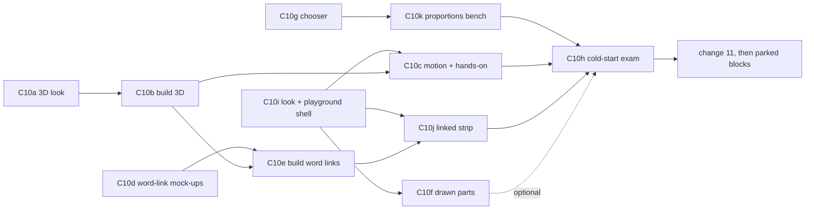

# C10: advanced visuals, in small blocks

Change 10 of `todo-draw-math.md`, split into blocks. A new planner reads [c10-handoff.md](c10-handoff.md) first (the user's wishes, sources, delegation), then its block's rows in the design, [c10-plan-v2.md](c10-plan-v2.md) (the chooser, the look as numbers, what each block adds, which pictures to name in briefs). **One block per chat.** When the user says "work on C10b" (or "the next C10 block"), read this file and "How we work" in `todo-draw-math.md`, then do that block only, with the loop below. When a block ends, set its status here, add a line under "Decisions", and update "State now".

Goal: a `class` lesson picks the picture that builds the right intuition (geometry, logic, an analogy, a worked case) and draws it as cleanly as the reference pages below. Every number stays computed; the lesson agent still writes short YAML.

## Who does what
| Role | Who | How |
|---|---|---|
| Orchestrator | the strong model the user starts the chat with (Fable, high) | plans the block, writes briefs, holds the design gate, shows the user options, keeps this file current. Builds nothing a cheaper worker can build (the two exceptions are in the handoff) |
| Implementer: mock-ups, playgrounds, kit, lint | Opus 5.5 medium (more effort only if a run fails at medium) | `--to claude --model opus --effort medium --role worker` |
| Technical review | Terra 6.1 high, or Grok 4.7 high when the user says. **In proportion (the user, 9 Nov; replaces "How we work" rule 2 for C10):** a mock-up block gets none; a kit change under about 150 lines gets one reviewer, one round, plus the orchestrator's probe; a larger change gets two reviewers, two rounds | `--to codex --model gpt-6.1-terra --effort high --role reviewer` / `--to grok --model grok-4.7 --effort high --role reviewer`; check `git status` after each |
| Reading, finding, screenshots, first-pass checks | Terra 6.1 high | `--to codex --model gpt-6.1-terra --effort high` |
| Second eye on design (untried: the user skipped the C10i trial, 9 Nov) | Gemini 4 Argon high | `--to agy --model gemini-4-argon-high --effort high --role reviewer` |
| Visual review and every design choice | **the user** | picks in a playground (the figure, an options panel, a settings line to send back); a picture or GIF only for a choice with one setting; never a diff |

All runs go through the agent-delegate dispatcher. If a run's status is not success or its model differs, report `error_message` and `.model` verbatim and stop.

## The loop for every block
1. Read this file, then the block's row and notes, then its rows in the design. Open the 2–4 reference pictures the design names for the block.
2. **Options first.** Opus builds the options as a playground in `out/c10/<block>/` (not in `plugins/`), on the shared look stylesheet and playground shell from C10i. Every brief has a "Look at" part: the look file and those pictures by path, each with one line to borrow and one not to copy.
3. **Design gate.** Open the screenshots yourself and hold them against the look numbers (design §4) and the references; also check console errors and numbers. Send it back to Opus once if it fails. Only then show the user, with the YAML and its token cost when the agent will write it. Repeat until the user sends a settings line.
4. Opus implements the pick in `plugins/viz-os/skills/class/` and tests it on the benches it touches: H&E (`out/c10/bench/`) and the proportions bench (`out/c10/bench-prop/`). It tries the change on 1–2 lessons of different types only and fixes no other lesson (the rule in `AGENTS.md`). Something that needs no extra reading or YAML goes to every lesson; anything else is adv-only (design §2).
5. Review in proportion (the table above); Opus fixes what is confirmed; you settle disputes by reading code or running a probe.
6. Rerun the test yourself; show the user before/after pictures; wait for approval.
7. Set the status, add a Decisions line, update "State now". Commit only when the user says.

Only one block edits `plugins/` at a time. Blocks that only make mock-ups (C10d, the first half of C10g) can run in a second chat beside it.

## Blocks
Your part: **pick** = choose between options; **review** = look at the result and approve; **tell** = give a fact only you have.

| Block | What | Your part | After | Status |
|---|---|---|---|---|
| C10a | 3D look: three mock-ups of the stain-plane scene: flat SVG, SVG with depth cues (floor grid, drop lines), lit WebGL (three.js) | pick a look, plus tweaks | — | done 8 Nov: B, with the settings line in Decisions; the playground `out/c10/h3d/b2-play.html` opens in it |
| C10b | Build the 3D figure `space`: the `plane` marks with a z, plus `sheet` (the span of two vectors) and `foot` onto a sheet; drag to turn; lint; ≤ 40 lines in `board.md`. Starts by showing 2 YAML shapes with token counts. Also makes the H&E bench lesson | pick the YAML shape; review | C10a | built 9 Nov (shape B), two review rounds, 8 confirmed findings fixed; quick check clean; approved by the user 9 Nov (committed in 3a568a8). Report `out/c10/c10b/report.md`, pictures `out/c10/c10b/before-after-fixes.png`, bench `out/c10/bench/` |
| C10i | Look and playground shell. Half 1 (mock-up only; can run beside C10g): the look numbers as one stylesheet and a reference page, plus a reusable playground shell from `out/c10/h3d/src/play.js`; the orchestrator writes the look page by hand; Argon critiques the same screenshots as a trial. Half 2: the picked look becomes the kit's default for every lesson | pick the look in the playground; review | — | half 1 done 9 Nov: the user picked the look (Decisions); Argon trial skipped by the user. Quarter labels: C (Decisions). Open `out/c10/c10i/index.html`; report `out/c10/c10i/report.md`. Half 2 built 9 Nov (the look as kit defaults, the `quarters` mark, pca-2 scene 5 redrawn; one review round, 4 confirmed findings fixed; quick check clean): **done, approved by the user 10 Nov**, not committed. Report `out/c10/c10i/half2/report.md`; pictures `out/c10/c10i/half2/before-after.png` |
| C10g | Chooser, adv only: `class/adv.md` (74 lines) with the idea table (a menu: a scene may state its own question), the depth budget, the figure contract (witness, handle, foil) and the picture plan as stub scenes (`idea`, `see`, `shows`); lint checks; `scripts/storyboard.py` draws the plan as `storyboard.svg`; `SKILL.md` +2 lines. Uses only what the kit already draws | pick the plan and storyboard format; review | — | built 9 Nov (strip, glyph, title + question, plan with `shows`), two review rounds, 9 confirmed findings fixed; quick check clean, 29/29 adv and link cases, six lessons byte-identical; approved by the user 9 Nov (not yet committed). Reports `out/c10/c10g/report.md` (playground), `report-build.md` (build and fixes); pictures `out/c10/c10g/shots/storyboard-script.png`, playground `out/c10/c10g/play.html` |
| C10k | Proportions bench and chance: a second bench lesson on a test of proportions; counts as `units`; `span` and `ruler` marks; "draw again" as a run over seeded draws | tell the exact question and toy table; pick the ruler look; review | C10g | built 10 Nov as one adv figure, `chance` (YAML shape B: the units, the share line, the gap and the tick ruler in one item; the kit's own run row is "draw again"; a tally strip of draws). Bench: 80 homes, well against piped water, a child ill in the past month, 18/40 against 9/40 (`out/c10/bench-prop/`). Two review rounds (two Terra reviewers), 6 + 6 confirmed findings fixed; the last fix checked by the orchestrator on the reviewers' probes. Quick check clean, 200/200 class cases, 11/11 doc tests, 32 pictures of the two quick-check lessons identical to the kit before the change. **Done, approved by the user 10 Nov**, not committed. Report `out/c10/c10k/report-build.md` (playground rounds: `report.md`); pictures `out/c10/c10k/before-after.png`; playground `out/c10/c10k/play.html` |
| C10c | Motion and hands-on: a named view per step (`edge` turns the sheet edge-on so the right angle shows), the camera glides between steps, the smooth run from the earlier mock-up (`out/c10/proto/`); plus a guess the learner drags on the sheet or plane, a predict stop that waits for the drag, `decomp` (the slanted split), and the edge-view tick clash | pick the glide feel, the handle and the reveal in the playground; review | C10b, C10i | todo |
| C10j | Linked strip: one shared pointer (a table row, its dot, its product row and its patch cell light together), `patch` (a grid of cells in their computed colours, one pickable), the `strip` stage. Redraws the three slop scenes without an image model | pick patch and strip layout; review | C10e, C10i | todo |
| C10d | Colour-matched words, mock-ups only: 2–3 ways a coloured word in a teacher line and its mark light each other up | pick | — | done 9 Nov: A, twin glow (Decisions); mock-ups and report `out/c10/c10d/` |
| C10e | Build the word links for `plane`, `chart` and `space`; names drawn on figures become rare; lint: each coloured mark has its coloured word in the scene | review | C10b, C10d | built 9 Nov (look A, `==pixel==`), two review rounds, 7 confirmed findings fixed; quick check clean, 156/156 cases; approved by the user 9 Nov (not yet committed). Report `out/c10/c10e/report.md`, pictures `out/c10/c10e/before-after.png` |
| C10f | Drawn parts: the sketch skill's parts (cell, nucleus, chromosome, tissue, tube, plate, read, droplet, lens) usable on a board; `fork` for 2–3 aligned outcomes; `image.py` refuses maths subjects (vector, plane, axis, arrow, graph). Anchors for image-model labels wait until the user asks for image-model pictures | pick dark-ink or paper-plate look and the layouts; review | C10i | todo |
| C10h | Cold-start exam: a cold Opus 5.5 medium agent builds two adv lessons from `plugins/` only (H&E and the proportions test); compared with the user's study chat; reports families used, checks, tokens | study both and judge | the blocks the user wants in | todo |
| later | Short films, generative art, illustrated parts from an image model, the agent-written widget (only from the kit's parts, browser-checked). Ask the user before proposing blocks | pick | C10h | parked |

Change 11 of `todo-draw-math.md` (prove it's general) comes after C10h. The user's picture of this map: https://claude.ai/artifact/2r7angg1HBwSeyk2UQMDpV (its status cards are as of 10 Nov, after C10k; this file is the truth).

Run order (9 Nov, chosen for cost): C10i half 1 beside C10g → C10i half 2 → C10k → C10c → C10j → C10f → C10h. The user can stop after any block.

## State now (10 Nov)
- **Next:** C10c. C10k is done (approved 10 Nov; pictures `out/c10/c10k/before-after.png`). C10e, C10g, C10i and C10k are approved but not yet committed (commit when the user says). From the user (10 Nov), on the old bench scene: the `dist` bell curve on a board "feels like it still stuck in old version of the plugin" (boxed labels on the plot, the grey card). It is drawn by the deck kit, which the C10 look never reached; a separate session was proposed for it, not started (`docs/issues/class.md`, Chance 101).
- C10k (10 Nov): the proportions bench is `out/c10/bench-prop/` (`make_data.py` seed 20261110, `verify_data.py` PASS; pooled share 33.75%, one noise step 10.57 points, the gap 22.5 points = 2.13 steps; 11 of 200 draws as far, exact 4.38%, smooth curve 3.33%; clustered step 17.60 points). This seed's draws are a little wide (SD 11.5 against 10.6 points); kept, not picked. The `chance` figure is adv-only (`class/adv.md` §9, now 88 lines). The user's settings line was `units=grid fill=packed axis=shares ruler=ticks ties=on pile=off draw=run layout=over`, then "Kit run row" for the control (`ties` does nothing with `axis=shares`). Open points: `docs/issues/class.md`, Chance 101–107. Earlier open question from the user (9 Nov, still not agreed): Open question from the user (9 Nov): a block for illustrated objects the learner can move (art from kit parts, agent-written SVG or an image model; arrows, measures and numbers always drawn by the kit) and a gallery of ready interactive scenes; proposed to sit after C10c, not yet agreed.
- C10i half 2 (9 Nov): the look is the kit's own default now (tokens in `board.css`; `board.js` draws with them), so a later mock-up built from a real lesson already wears it and needs `out/c10/c10i/look.css` only for its tokens and the shell. Tried on pca-2 and the H&E bench only. Still open: the three rulings below (fill, hues, witness) and the points in `docs/issues/class.md` (Look 95–100).
- C10i half 1 (9 Nov): `out/c10/c10i/` holds `look.css` (the §4 numbers as tokens, then CSS-only rules on the kit's figures), the reference page `index.html`, the shell (`shell.js`, `shell.css`: `PG.init`) and two playgrounds made by `build.py` from real lessons. Later mock-ups import `look.css` and the shell. Four rulings wait for the user (`report.md`): fill passes over the sweep but a plane looks empty at one moment (the kit widens x to fill 16:9; height is the limit); the bench has 5 mark hues against a cap of 4; `wide` gains 18% on a plane and shrinks a 4:3 figure; "the accent mark is the witness" picks the wrong mark on the bench. The Argon trial was skipped by the user. The user's note on pca-2 scene 5 (the four `product +/−` words: misplaced, and not nice in green and pink): the colours came from a look rule that tinted every name with its mark's colour; the look now tints only a name that sits beside a drawn mark, and words written on a plot by themselves stay axis grey. The misplacing is the kit's (the top-left word is right-anchored and crosses the box); `quad.py` draws three cures for a picture only; the user picked C, and building it belongs to half 2.
- Plan v2 (9 Nov): the design is in `c10-plan-v2.md`; the helper reports behind it are in `out/c10/plan2/` (`inventory.md`: which figures the examples use; `refs.md`: the references, ranked; `argon.md`: Argon's ideas).
- Research done: `out/c10/research.md` (Sol 6.1: options and token cost), `out/c10/inspire/notes.md` (Terra: how the reference pages are made), `out/c10/inspire/gptchat.md` (the user's study chat, digested; full text beside it).
- Earlier mock-ups on the leak dial: `out/c10/proto/` (smooth run, finer grid, one pixel's path). The user liked them; the smooth run goes into C10c.
- C10a mock-ups: `out/c10/h3d/` (open `index.html`; `a-flat.html`, `b-cues.html`, `c-lit.html`, `report.md`, `shots/`, `vid/`, data from `make_data.py`, checked by `verify_data.py`: PASS). Shown to the user: `compare-3d-looks.png` (3 looks × 3 views) and `compare-3d-turning.gif`. All three run at 60 frames a second while dragging (headless; WebGL on a software renderer, so GPU speed is untested); C doubles the page weight (283 KB with three.js 0.170.0) and its lighting shifts the dots' true colours.
- C10a playground (8 Nov): `out/c10/h3d/b2-play.html`, built by `build_play.py` from `src/play.css` and `src/play.js`; shots by `play_shots.py` into `play-shots/`; side by side in `compare-playground.png`. It uses the class kit's sliders, toggle words, glass card and frame rule; names are plain coloured words with a halo (no boxes) and a thin leader when far; no text selection or focus ring from a drag; zoom by pinch, ⌘ or ctrl + scroll, the + − buttons or keys; "fit" and "edge" (look along the sheet) buttons; axes sized to the data and the figure fitted to them. The options panel (palette, dot colouring, ground, frame, layout, shape, axes or back panes, ticks, floor, drop lines, depth fade, perspective, sheet, line weight, dot size, names, legend) writes a settings line the user sends back. Page unmixing matches `data.json` to 1.1e-15; no console errors.
- Fix in C10b whatever look wins: the scene fills only about 40% of its plate (one scale for every view; fit it to the plate instead); dragging selects label text in A and B (blue highlight in the GIF; needs `user-select: none`); boxed tags go (colour-matched words instead); "DAB pixel" hides in 8–16% of views; start edge-on when the point is the right angle.
- A teaching point from the data: the DAB pixel, made from 0.30 H, 0.20 E and 0.60 DAB, unmixes to ĥ 0.72, ê 0.27. Part of an unnamed stain is counted as H, not only left in the residual. Use it in the H&E lesson's limits scene.
- Stain vectors used: Ruifrok & Johnston 2001 as given in scikit-image 0.25.0 `rgb_from_hed`: H = [0.65, 0.70, 0.29], E = [0.07, 0.99, 0.11], DAB = [0.27, 0.57, 0.78]. H and E are 39.4° apart; DAB sits 36.5° off their plane.
- Draft of the H&E lesson's picture plan: `out/c10/plan.md` (bottom table).
- C10d mock-ups (9 Nov): `out/c10/c10d/` (`a.html`, `b.html`, `c.html` and `-plane` versions; `compare-word-links.png`, `compare-plane.png`, a GIF per option; `report.md`). Injected script `src/wl.js` / `wl.css` by `build.py`; the kit is untouched. C10e starts from `wl.js` and the clashes listed in `report.md`: `==text==` already means an orange underline, so a typo in a mark name falls back silently (lint it); a linked `==H==` must count as the symbol `$H$`; two linked marks may not share a colour (pixel ring and residual were both orange); plane marks need real pointer areas. Not tested: touch, Safari, Firefox, a narrow window.

## What the user wants and likes (C10)
- Visuals chosen for intuition: the right picture, analogy or worked case, the way their ChatGPT study chats choose (prerequisites first, observed / predicted / residual together, an edge-on view, every multiplication traced, a tempting shortcut compared with the answer).
- The look of the references, as inspiration, never copies: [ciechanow.ski](https://ciechanow.ski/bicycle/) (one control drives one visible cause and effect; clean; no overlaps; good colours), [Pele diagrams](https://pele-art-diagrams.vercel.app/) (labels laid out before drawing; one restrained palette), [kevintngo.com](https://kevintngo.com) (detail and craft), [CNN Explainer](https://poloclub.github.io/cnn-explainer/) (linked views).
- Dislikes: image-model pictures that draw the maths, and dark label boxes pasted over the figure ("slop").
- Labels: colour-matched words. The figure carries almost no text; a mark shares its colour with a word in the teacher lines; pointing opens the card.
- Pictures from an image model only when the user asks; the user names the tool.
- Shown options often, as pictures; token-efficient YAML without losing quality.
- Options as a playground with enough settings to choose from and to tune layout (9 Nov).
- The theme is black and orange; orange is not kept for one mark (9 Nov).
- High quality at low cost: the strong model thinks, checks and gates; cheaper workers read and build (9 Nov).
- No fixed list of what a scene may be about, and no fixed count of examples: some topics need more of one thing. Depth is asked, default 1–2 per idea (9 Nov).
- Variety from pictures like Ciechanowski's gravity figure: an illustrated body (an image or an SVG) that the learner drags or resizes, with coloured sliders; and ready JS examples (9 Nov; not yet a block).

## Decisions (C10)
- 10 Nov (C10k): the test of proportions is drawn by **one figure, `chance`** (shape B, 49 tokens in the playground against 113 for separate `units`, `span` and `ruler` marks): two groups as grids of countable units (10 a row, filled first), one share line from 0 to 100% with a marker per group, the gap as the witness (`gap`, pink), a tick ruler from the lower share in noise steps (`noise step`, mint; at most 12 ticks, none past 100%), and an optional tally strip, one square per draw, pink when that draw reached the observed gap. **No new control** (the user: the playground's bordered buttons were "not a big fan of this UI if this is aimed to be present in the main lesson"): "draw again" is the scene's ordinary run row, frame 0 the data; the user picked it over a quiet word and icon buttons. No pile of gaps and no bell curve in the scene; the exact and smooth values are compared as text in the think stop. One `chance` a scene; `gap` and `noise step` are the figure's own names. **The lint proves, the page guards:** the lint gives an error only for what it can read (numbers, data, one control's states, `at(list, control)`); a value inside arithmetic passes it, and the page clamps the drawing and warns in the browser check. A `chance` placed on a later step stays hidden, its room kept, until the reading reaches it. New motion token `--m-state: 450ms`. Rows in `plugins/viz-os/docs/design.md`. Approved by the user.
- 9 Nov (C10g): the picture plan is stub scenes in block style at the top of `lesson.yaml` (`idea`, `see`, `shows`, title, lead; `{ }` style broke on commas and `?`). The storyboard the user picked: `show=adv layout=strip icon=glyph colour=kit text=stuck meter=off checks=off plan=shows` (cards with title and the learner's question; `shows` and `see` on pointing). **The idea table is a menu, not a fence** (the user): `idea` may be the learner's own question ending in `?`. **A depth budget replaces the fixed variety rule** (the user): the adv probe asks how deep (default 2 scenes per idea, 1–6), stored as `learner.depth`; the lint warns only when one idea fills more scenes than that. The design's check 4 (a family in more than 3 scenes; fewer than 4 families) is not built. Every idea maps to items the kit draws today; later blocks swap in the real figure by editing one table row. Not built: the `adv-gallery` example and the browser checks 5–6. Approved by the user.
- 9 Nov (C10i): the look is the playground's "after" as it stood: `look=after lines=look wit=3.5 glow=soft frame=faint grid=faint stage=split ctl=under knob=orange` (sent from the pca-2 page; the bench-only view buttons were not in the line, so they keep the default, a row on the figure's top rule). Words written on a plot by themselves are never coloured. The Argon design-critique trial was skipped by the user, so Argon as a second eye on design stays untried. Quarter labels on a plot (pca-2 scene 5): **C**, the positive quarters lightly washed with a small + or − in each outer corner, no words (`out/c10/c10i/compare-quad.png`); half 2 builds it as a region mark in the kit and redraws that scene. Not ruled yet: fill at one moment, the cap of 4 hues, the witness rule (`out/c10/c10i/report.md`).
- 9 Nov (C10i half 2): the look went into the kit as its defaults, not as an override layer: three line weights as tokens, the accent mark as the stand-in witness, ticks at 13 px with a narrow exception in the page audit, the 3D view buttons in the legend row. `quarters: [cx, cy]` is a plane mark for every lesson (one row in `board.md`); a sign shows only when its quarter is at least 40 px each way. Dot labels of a `points` mark stay grey (a reviewer wanted them coloured; the user's pick shows them grey). **Try a change on 1–2 lessons of different types and fix no other lesson** (the user; the rule is in `AGENTS.md`). Rows in `plugins/viz-os/docs/design.md`. Approved by the user 10 Nov.
- 9 Nov (plan v2): blocks re-cut and re-ordered (table above). `adv` stays opt-in. What needs no extra reading or YAML reaches every lesson (the look, glide, smooth run, shared pointer); what costs tokens or needs an image is adv-only. The second bench is a test of proportions. Review is in proportion to the change. Linked views moved before the exam; the pictures fix became drawn parts (no image model); image-model anchors are parked. Each block runs in a new chat started with the strong model.
- 9 Nov (C10e): word links built as look A for `plane`, `chart` and `space`; a space `foot` defaults to teal (`s2`) so it never shares the ringed point's colour; a plane `name:` is not drawn when a linked word names the mark. Approved by the user.
- 9 Nov (C10d): word links look A, **twin glow**: the word stays bold in its mark's colour; pointing at it (or Tab) brightens the mark with the legend glow and dims the other marks to about 30%; pointing at the mark or its legend entry gives each matching word a soft wash of its colour (no box, no underline, no line drawn to the mark). The legend stays. Pointing at a word does not open the card (it would cover the lines being read); a word whose mark comes in a later step stays at 75% and does nothing until then (no spoiling a think stop); the pixel's word takes its ring colour. Not picked: B (a line from word to mark crosses buttons or text) and C (glyph words in place of the legend; loses the keyboard route to cards). No click-to-pin (the user, 9 Nov: not for now). Author syntax, confirmed by the user: `==pixel==` links to the mark labelled `pixel` and takes its colour; `==pixel:Your pixel==` for other words (97 vs 111 tokens on the bench lines).
- 9 Nov (C10b): `space` takes shape B (named vectors); the kit sizes the axes by sampling 5 values per control (all combinations up to 4096, then a seeded sample) and warns if a mark later leaves them; `edge` searches every direction in the sheet and turns perspective off while edge-on (back to mild on the first drag); a span thinner than sin 1e-6 draws no foot and warns.
- 8 Nov (C10a), the look C10b builds: `palette=kit dots=true bg=page frame=kit layout=beside shape=r43 axes=lines ticks=on floor=grid drops=off depth=on persp=mild sheet=tint weight=fine size=m names=legend legend=on`. So: kit violet/pink, dots in true colour, the kit frame rule, figure beside the text at 4:3, three axes with tick numbers over a floor grid, no drop lines, depth fade and mild perspective, the sheet tinted from E to H, fine lines; no mark names on the figure (only axis names), the legend row names the marks and lights them on hover. Zoom with a plain mouse scroll toward the pointer; scrolling down at the fitted size scrolls the page, so a reader moving down the lesson is never caught; pinch or ⌘/ctrl + scroll can go below the fitted size; + / − / fit / edge buttons stay.
- 8 Nov (C10a): the user picked B, SVG with depth cues, and asked for zoom and a better look; the 3D figure reuses the class kit's controls, not its own control strip.
- 8 Nov: test bench is H&E colour unmixing (least squares onto the stain plane). First kind: 3D you can turn. The picture plan is shown only when the user says "adv". Kit first; an agent-written widget later, built only from kit parts. Labels: colour-matched words. After 3D: the labels and pictures fix.
